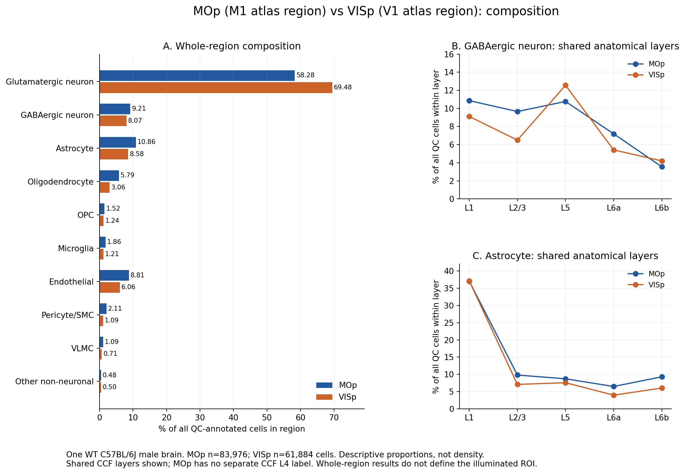
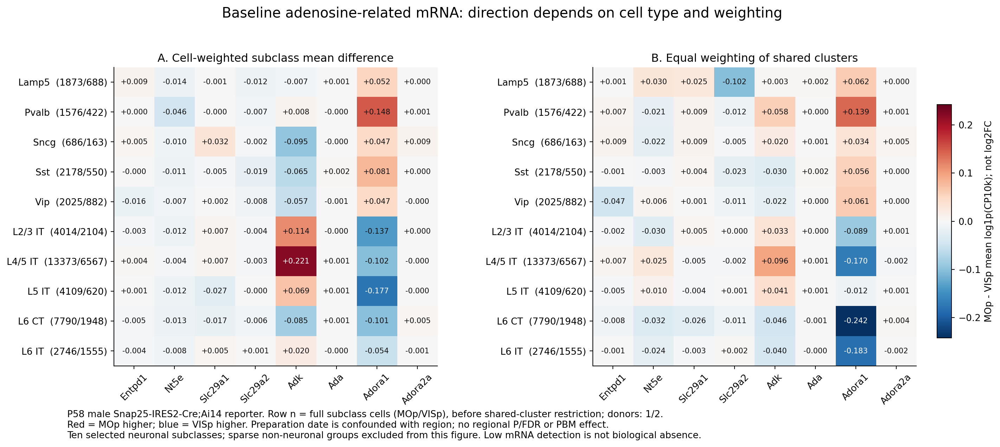
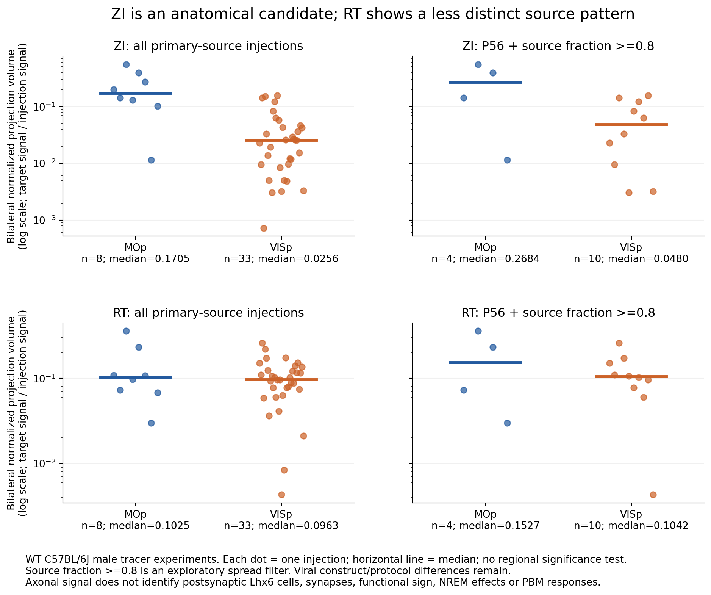

# M1–V1 데이터가 무엇을 말해주며, 다음에 무엇을 해야 하는가

2026-10-12. 원 분석 결과의 기준 커밋: `bc392b8096a4706b14bc56378b1336f12fff7fb7`(검토 시작 시 GitHub `main`과 로컬이 일치). 기존 대화 「연구 질문 정리」와 「프로젝트 분석 계획」, 저장소의 원 CSV·상태 JSON·계산 코드를 함께 확인했다. 이후 대화에서 만든 비교 그림·후보 검토·bulk qPCR 해석도 이 안내서에 연결했다.

**현재 자료는 M1–V1의 기저 세포 구성·후보 발현·해부학적 투사 차이로 후속 실험을 좁히는 데 사용할 수 있다. 현재 PBM에서 M1만 수면이 늘어나는 원인을 확정하거나 수면 유도 역치를 계산할 단계는 아니다.**

랩미팅에서 정리한 질문은 다음처럼 유지하는 편이 좋다.

> **왜 현재 PBM 조건에서 M1 자극의 수면증진 반응이 관찰되고 V1에서는 검출되지 않는가? 그 차이는 국소 adenosine 순축적, 같은 adenosine에 대한 반응, 또는 국소 변화가 수면 회로로 전달되는 과정 중 어디에서 발생하는가?**

M1·V1은 실험 영역명, MOp·VISp는 비교한 Allen atlas 영역명이다. 실제 광섬유 주변 조직과 atlas 영역 전체가 동일한 분석 단위는 아니다. 「M1만 반응한다」는 현재 사용자가 제공한 실험 관찰을 전제로 한다. 이 저장소의 atlas 자료로 EEG/EMG 효과 크기나 region×PBM interaction을 새로 검증한 것은 아니다.

## 1. 실제로 수행된 분석과 파일의 역할

Markdown은 계획·해석·방법을 기록하는 문서다. 실제 계산 근거는 입력 자료와 Python 코드, CSV/Excel 결과다. `validation passed`는 파일·분모·계산의 검증이며 기전의 실험적 검증을 뜻하지 않는다.

| 자료 묶음 | 실제 수행한 일 | 현재 답할 수 있는 질문 | 바로 볼 파일 |
|---|---|---|---|
| 기존 PBM DEG·ORA | 제공된 DEG/ORA 표에서 올바른 PBM contrast 선택, 통계·hit 정합성 확인, 공통 유전자·GO와 qPCR 후보 정리 | 서로 다른 PBM 연구에서 어떤 후보가 반복적으로 나타났는가? | [최신 DEG 보고서](../../ora_analysis/deg_validation/DEG_aware_qPCR_report_ko.md), [PBM 연결 보고서](../results/pbm/PBM_bridge_report_ko.md) |
| B6J MERFISH | 정확한 MOp 83,976 / VISp 61,884 QC annotated cells의 영역·층·세포 유형별 count와 비율 | 어떤 세포가 어느 영역·층에서 상대적으로 더 많이 표집되는가? | [구성 보고서](../results/merfish/composition_report_ko.md), [영역 비율 CSV](../results/merfish/composition_region_major.csv) |
| 10x RNA-seq | MOp 123,727 / VISp 29,763 cells, 62개 후보의 평균 log1p(CP10k)·검출률. P58 및 공유 cluster 가중치 민감도 | 같은 세포 유형에서 후보의 기저 발현이 어떻게 다른가? | [발현 보고서](../results/rnaseq/RNAseq_results_ko.md), [P58 후보 민감도 CSV](../results/rnaseq/panel22_P58_cohort_cluster_sensitivity.csv) |
| SMART-seq v4 | MOp 6,588 / VISp 15,572 cells, 62개 후보의 별도 기술통계; 자료 내부에서 조건을 맞춘 38개 표시 strata | 다른 reporter·연령 조건에서 어떤 발현 패턴이 보이는가? | [별도 분석 설명](SMARTseq_analysis_ko.md), [상태 JSON](../results/rnaseq/smartseq/status.json) |
| Allen Connectivity | 168개 주입 실험의 7개 표적·3개 반구 신호. WT MOp8/VISp33 주 분석, Cre line 별도, 주입 순도·P56 민감도 | 후속 tracing·기능 검증을 어느 표적부터 할 것인가? | [투사 보고서](../results/connectivity/NREM_projection_report_ko.md), [별도 Excel](../results/connectivity/MOp_VISp_NREM_projection.xlsx) |

기존 PBM 두 비교는 제공 metadata 기준 **808 nm·5xFAD 해마**와 **1064 nm·저산소 PFC**다. 같은 방향 DEG는 **52개(up34/down18)**, 두 up ORA의 공통 유의 GO는 **38개**, 그 항목의 실제 공통 hit 유전자는 **19개**다. 이것은 38개의 독립적인 기전이 검증됐다는 뜻은 아니다. 항목 간 유전자 중첩이 많다. 기존 수치 51개와 최신 52개의 차이는 전체 DEG에서 확인한 Tmem40 common-down 추가 때문이다.

GO 주제는 시냅스 신호·구조, 이온채널·칼슘 수송·막전위 등에 집중된다. 미토콘드리아 관련 개별 후보가 있다는 사실과 OXPHOS gene set이 유의하게 활성화됐다는 주장은 다르다. 기존 cortex OXPHOS ORA는 유의하지 않다.

**아직 수행되지 않은 것:** 정상 MOp–VISp의 전장 pathway/module score·GSEA·GSVA·TF 분석, 독립 동물 pseudobulk DE 검정, 실제 자극 ROI 분석, MERFISH Penk 공간 발현, M1–V1 PBM 처리효과·adenosine 측정. B6N MERFISH는 실측 gene coverage 확인이며 새 공간 발현·구성 비교가 아니다.

중복 경로의 `onboarding_validation/`, `input/pbm/repository/`는 검증 산출물·원본 복사본이다. 새 독립 연구나 추가 biological replicate로 세지 않는다. 최초 ZIP·기존 루트 ORA 보고서보다 위 최신 DEG 보고서와 `allen_mop_visp/results/`를 먼저 읽는다.

## 2. M1–V1 차이: 구성, 같은 세포의 발현, 투사를 나누어 읽기

### 2.1 세포 구성

아래 분모는 각 영역의 **전체 QC annotated cells**다. WT B6J 수컷 한 동물에서 관찰한 비율이며 조직 밀도·일반적인 동물 평균은 아니다.

| 세포군 | MOp | VISp | 관찰 내용 |
|---|---:|---:|---|
| Glutamatergic neuron | 58.28% | 69.48% | VISp의 표집 비율이 높음 |
| GABAergic neuron | 9.21% | 8.07% | 전체 분모에서는 MOp가 높음 |
| Astrocyte | 10.86% | 8.58% | 전체 분모에서는 MOp가 높음 |
| Oligodendrocyte | 5.79% | 3.06% | MOp가 높음 |
| Endothelial | 8.81% | 6.06% | MOp가 높음 |

뉴런만 분모로 하면 GABA는 **13.64%/10.40%**다. GABA 내부 Pvalb는 **35.83%/42.74%**로 VISp가 높고 Sst는 **29.93%/29.74%**로 유사하다. 비교마다 분모를 유지해야 한다.

뉴런 내부 transcriptomic `L4/5 IT`는 **18.05%/34.49%**, `L6 IT`는 **12.68%/6.53%**다. 따라서 전체 영역의 유전자 평균은 해당 세포군의 비율에 크게 영향을 받을 수 있다. `L4/5 IT` subclass명과 해부학적 L4는 같은 정보가 아니다. MOp에 별도 CCF L4 label이 없어도 L4/5 IT 세포는 존재한다.

**광자극과 연결할 때 더 중요한 것은 깊이이다.** L1 Astro는 **37.05%/37.14%**로 거의 같고, L5 GABA는 **10.77%/12.56%**로 전체 영역과 반대 방향이다. 전체 Astro 비율에서 곧바로 「M1의 표면 PBM이 adenosine을 더 만든다」로 넘어갈 수 없다.

### 2.2 같은 세포 유형에서의 발현

핵심 panel22는 adenosine8, 기존 PBM8, 전기생리4, 미토콘드리아2로 구성한다. PBM 공통52개와 합친 중복 없는 탐색 목록이 62개다. 유전자 하나의 발현, gene set의 enrichment, 실제 대사 flux는 각각 다른 측정이다.

P58 10x Adora1의 예는 다음과 같다. 평균 단위는 **log1p(CP10k)**이며 log2FC가 아니다.

| 세포 유형 | MOp 평균 | VISp 평균 | 검출률 MOp/VISp | 공유 cluster 동일 가중치의 MOp−VISp |
|---|---:|---:|---|---:|
| Pvalb | 0.3545 | 0.2067 | 45.81%/35.31% | +0.1392 |
| Sst | 0.2876 | 0.2068 | 37.47%/35.45% | +0.0562 |
| L2/3 IT | 0.4410 | 0.5779 | 55.51%/72.29% | −0.0890 |
| L4/5 IT | 0.8984 | 1.0006 | 78.91%/86.78% | −0.1700 |

**일부 interneuron의 Adora1은 MOp 쪽, 일부 흥분성 세포는 VISp 쪽이다.** 「M1의 A1 receptor가 전체적으로 높다」는 설명은 성립하지 않는다. 수용체 mRNA가 높다는 사실도 같은 adenosine에서의 전류·firing·수면 반응 크기를 직접 알려주지 않는다.

Entpd1/CD39–Nt5e/CD73, Slc29a1/2/ENT1/2, Adk, Ada의 발현도 일관된 MOp 우세가 아니다. ADK는 제거·대사에 관련되므로 발현 증가를 순축적 증가로 읽으면 안 된다. ENT는 농도 구배 등의 영향을 받는 수송체이므로 mRNA로 순방향을 정할 수 없다.

아래 왼쪽은 원래 subclass 평균, 오른쪽은 공유 cluster들에 동일 비중을 부여한 결과다. 차이가 바뀌면 세부 세포 유형 구성·선택에 민감한 관측이다. 이 작업은 region–batch 교란을 없애거나 실제 조직 구성으로 표준화하지 않는다. 그림의 n은 공유 cluster로 제한하기 전의 전체 P58 subclass 세포 수다.

희소 Astro는 별도 [audit CSV](../results/discussion/adenosine_astro_sparse_audit.csv)에 둔다. P58 Astro n125/59의 공유 cluster가 n123/57와 n2/2인 두 집단이어서, 동일 가중치에서는 n2/2 집단이 절반을 차지한다. 여기서 큰 표준화 차이는 안정된 지역 기전의 근거가 되기 어렵다.

기존 PBM PFC에서 Nt5e log2FC **−0.5367**, Adora2a **−1.2929**가 보고되었다. 해당 조건의 처리 후 발현 변화이며 정상 M1/V1의 현재 810 nm 반응으로 대입할 수 없다. 다른 adenosine 후보가 제공된 FDR-selected DEG 표에 없다는 것은 변화 없음이나 발현 부재가 아니다.

**RNA-seq dotplot을 읽을 때:** `exploratory_cohort_common_down18/up34_dotplot`은 P57–P59를 포함한 기저 atlas 발현이다. 각 행은 `Region | class | subclass (n=세포 수)`이며, 기존 그림은 VISp block이 위쪽·MOp block이 아래쪽이다. 같은 subtype의 두 영역 행을 찾아 비교한다. 색은 평균 log1p(CP10k), 점 면적은 raw count>0의 검출률이다. 큰 점은 그 세포군의 비율이나 세포 수가 많다는 뜻이 아니다. 보라→노랑은 낮은→높은 평균 발현으로, MOp−VISp 차이·PBM 변화·p-value를 표시하지 않는다. 두 원 그림은 색 범위가 각각 0–3.053, 0–4.250이어서 그림 사이의 같은 색을 같은 값으로 비교할 수 없다.

`down18/up34`는 기존 두 PBM 연구의 공통 DEG 방향이다. Arpp21이 현재 atlas에서 감소하거나 Dlgap1이 MOp에서 증가했다는 뜻이 아니다. Arpp21은 IT에서 Pvalb보다 평균·검출률이 훨씬 높은 세포 유형 패턴을 보인다. 지역 비교는 예를 들어 L2/3 IT에서 MOp2.712/VISp2.997이다. Dlgap1은 여러 neuronal subclass에서 검출률이 거의 100%이며 L4/5 IT 평균은 MOp3.132/VISp2.977, Sst는 MOp3.291/VISp3.420으로 지역 방향이 세포 유형에 따라 다르다. Dlgap1/L6 CT는 공유 cluster 가중치에서 지역 방향이 바뀌므로 원 dotplot의 색만으로 안정한 지역 효과를 주장하지 않는다.

두 후보의 기존 수치를 바꾸지 않고 같은 subtype의 MOp/VISp 행을 붙인 [비교 그림](../figures/discussion/04_arpp21_dlgap1_paired_dotplot.png)을 추가했다. 이 새 그림은 두 유전자에 공통 색 범위를 쓰며 점 옆에 평균·검출률을 표시한다. 열별 색 차이보다 같은 열·같은 subtype 안에서 Region을 비교한다. 희소 glia 및 n=1 등의 불안정한 행은 이 안내용 그림에 포함하지 않았다.

후속 요청에 따라 **RNA-seq의 기존 6개 dotplot 전부**에 [인접 MOp–VISp 행 비교](../figures/rnaseq/paired/README_ko.md)를 추가했다. 3개 P57–P59 탐색 panel과 3개 연령별 panel22가 대상이며 원래의 세포 유형·수치를 모두 보존했다. 작은 n을 표시하고 없는 그룹은 N/A로 유지한다. 색 범위는 전체 공통 0–4.25이고, [요약 PDF 6페이지](../figures/rnaseq/paired/all_six_paired_dotplots.pdf)와 [숫자판 PDF 20페이지](../figures/rnaseq/paired/all_six_numeric_detail_pages.pdf)를 제공한다. P58만 두 영역이 모두 있으므로 연령을 맞춘 지역 비교는 P58을 먼저 본다. P57 MOp와 P59 VISp를 서로 짝지어 표시하지 않았다.

[후속 후보 검토](../results/rnaseq/paired_dotplots/gene_observation_review_ko.md)는 Adora1·Adk와 더불어 Ppargc1a·Zeb2·Grid1·Tnr·Sphkap·Stxbp6 등의 특정 subclass 관측을 정리한다. P58와 넓은 cohort의 공유 cluster 결과, 작은 cluster 제외 민감도를 함께 확인했다. Adora1/L6 CT는 P58에서 큰 VISp 방향 차이가 있었지만 넓은 cohort의 공유 cluster 차이는 거의 0이므로 Pvalb보다 우선 후보로 강조하기 어렵다. 이 검토는 독립 재현이나 동물 검정이 아니다.

### 2.3 Projection

WT 주입 전체에서 양측 **ZI NPV 중앙값은 MOp0.1705/VISp0.0256**이다. 정확 P56와 source signal fraction≥0.8 조건에서도 **0.2684/0.0480**으로 방향이 유지된다. 후속 해부학 후보로 ZI를 우선할 근거다.

NPV는 `target projection signal volume / 전체 injection signal volume`이다. 시냅스 수·연결 확률·Lhx6 세포 입력·PBM 전달 효율이 아니다. 주입 순도 필터 후에도 viral construct·프로토콜 등의 차이가 남는다.

RT는 전체에서 **0.1025/0.0963**으로 비슷한 수준이다. VLPO·MEPO는 작은 신호와 주입 조건에 민감하고, PZ는 exact atlas label이 없어 미평가다. 「M1이 모든 수면 영역에 더 많이 연결된다」로 일반화할 수 없다.

## 3. PBM 반응을 설명할 경쟁 가설과 판별 방법

| 단계 | 가설 | 현재 자료의 기여 | 실제로 판별할 측정 |
|---|---|---|---|
| 유효 광입력 | 두 영역에 도달하는 빛·조사 부피·온도가 다름 | ROI와 조직 dose 미검증이라는 제한 확인 | 위치 검증, 광학 보정, 깊이·온도, 조건을 맞춘 용량–반응 |
| 국소 순축적 | M1에서 PBM 후 extracellular adenosine 상승·유지가 큼 | 구성·대사/수송 후보를 제안; 일관된 생성 우세는 미확인 | M1/V1×sham/PBM에서 상승, AUC, 감쇠·회복 비교 |
| 같은 입력의 반응 | 비슷한 adenosine에도 세포·국소 회로 반응이 다름 | 일부 interneuron Adora1 차이, 흥분성 세포의 반대 방향 | 동일 국소 adenosine 또는 A1 agonist 입력의 농도–반응, 세포별 전기생리·LFP |
| 국소→전신 전달 | 국소 변화가 M1에서 수면 관련 downstream 회로에 더 잘 연결됨 | MOp→ZI 해부학적 신호를 후보로 제안 | 표적 세포·시냅스·부호 확인, ZI 활동, PBM×projection별 개입, EEG/EMG |

GRAB-Ado를 쓴다면 sham 대비 시간 변화를 비교하되 영역 사이의 ΔF/F가 동일한 절대 농도라고 가정하지 않는다. 센서 발현·광학 수집·artifact·control을 확인한다. AUC는 생성만이 아니라 수송·제거까지 반영하는 순축적 지표다.

Interneuron A1이 활성화되면 해당 interneuron의 firing 감소와 pyramidal disinhibition이 생길 가능성도 있다. **Adora1↑→피질 억제↑→NREM↑**라는 단일 부호의 연결을 현재 자료로 그릴 수 없다. MOp→ZI 신호도 실제 postsynaptic Lhx6 identity와 부호가 미확인이다. ZI Lhx6 문헌에서 NREM·REM 효과는 시간·조작 조건에 따라 다르다.

과거 대화의 V1 adenosine–수면 논문은 [Zhou et al., 40 Hz flicker](https://doi.org/10.1038/s41422-023-00920-1)이다. V1도 특정 자극에서 adenosine과 수면을 연결할 수 있다는 근거지만 현재 810 nm 연속광 PBM의 지역 비교가 아니다. 그 ENT2 결과를 CD39/CD73 경로의 입증으로 읽지 않는다. 문헌 접근·검증 범위는 [기존 가설 문서](M1_PBM_sleep_sensitivity_hypothesis_ko.md)에 기록되어 있다.

현재 발표에서 적절한 문장:

> 현재 자극 조건에서 M1의 수면증진 반응이 관찰되었다. Atlas에서는 MOp–VISp의 구성, 세포 유형별 Adora1 발현, ZI로의 투사 신호 차이가 관찰된다. 이 결과를 바탕으로 국소 adenosine 순축적과 반응·전달 단계 중 어느 과정이 지역 차이를 만드는지 검증한다.

## 4. 현재 자료로 더 할 수 있는 분석

| 우선순위 | 분석 | 필요 자료·조건 | 얻을 수 있는 것 |
|---|---|---|---|
| 높음 | 지금 결과를 전체→공유 층→subclass→공유 cluster 순서로 좁힘 | 기존 MERFISH/RNA CSV | 어떤 차이가 분모·세부 구성에 민감한지 파악; 후보 선정 |
| 높음 | 실제 자극 ROI의 깊이별 구성 | 확정 좌표, bregma–CCF 등록, 검증된 광학 footprint | 전체 영역 관찰이 실제 자극 조직에도 적용되는지 |
| 중간 | Adenosine, A1 하위 신호, Ca²⁺, OXPHOS 등의 완전한 모듈·전장 gene-set 탐색 | 원본에서 전장 또는 사전 정의 모듈의 모든 유전자 추가 추출 | 경로 내 유전자들의 일관성·기여·coverage. 독립 동물 유의성은 해결되지 않음 |
| 중간 | B6N 공간 자료의 Adora1/Adora2a 및 B6J Penk 확인 | 실측 expression matrix와 별도 genotype/표집 audit | 공간 발현 보완. B6N을 B6J replicate로 합치지 않음 |
| 중간 | ROI에 가까운 tracing 실험·Cre line별 출력, 관련 시상 입력 조사 | 주입 중심·line·표적 정의; 필요시 추가 atlas 조회 | 지역 출력과 특정 집단을 좁힐 후보 |

보관 H5AD는 62개 후보만 담고 있다. 전체 library 분모가 있다는 사실이 전장 발현 행렬을 의미하지 않는다. **62개를 전체 background로 GO/GSEA를 돌리면 후보 선택 편향이 생긴다.** 전체 경로 유전자 추출 및 동일 세포 유형 비교를 먼저 해야 한다. SMART-seq은 10x exact P58/reporter 조건을 재현하는 strata가 0개여서 직접 재현 확인에 사용할 수 없다.

Anterior/posterior spindle 질문에는 지금의 RT 축삭 신호만으로 답할 수 없다. M1–V1/전후부 LFP에서 spindle 빈도·density·slow-wave coupling 및 coherence/발생 순서를 측정하고, 관련 thalamocortical 입력을 별도로 정의해야 한다. 마우스의 전후부 주파수 차이를 인간 fast/slow spindle 체계와 자동 대응시키지 않는다.

## 5. 후속 실험의 순서와 결과별 다음 행동

1. **지역별 PBM 효과의 직접 비교를 먼저 확립한다.** 같은 조건의 M1/V1×sham/PBM EEG/EMG를 사용한다. 1차 endpoint는 사전에 정한 시간창의 NREM 시간 변화로 두고 자극 중/후 창을 구분한다. 동물·순서·ZT·기저 수면압력·성별·연령을 기록한다. Region×treatment interaction 또는 `(PBM−sham)_M1−(PBM−sham)_V1`를 추정하고 효과 크기·신뢰구간을 제시한다. 반복측정 여부에 맞는 동물 짝지음을 보존한다. 필요한 n은 행동 변동·예상 효과를 이용해 정하며 atlas 세포 수로 계산하지 않는다.
2. **Adenosine dynamics를 같은 비교에 연결한다.** 국소 상승·AUC·감쇠와 LFP/EEG/EMG를 측정한다. M1의 순축적이 더 크면 생성·방출·제거 쪽 실험을 우선한다. 비슷한 순축적에도 행동이 다르면 같은 입력의 반응·회로 전달에 우선순위를 둔다.
3. **같은 adenosine 입력에서 반응을 비교한다.** Vehicle과 국소 농도/확산을 확인한 adenosine/A1 agonist 농도–반응으로 국소 생리와 수면 효과를 비교한다. 입력 농도와 실제 국소 노출의 차이를 구분한다. A1 blocker×PBM 실험에는 blocker 단독 대조도 포함해 baseline 수면 변화와 PBM의 추가 효과를 나눈다.
4. **발현 후보는 위치·세포 유형을 함께 검증한다.** 먼저 Adora1/Pvalb·Sst·IT를 확인하고, 순축적 결과에 따라 Slc29a2·Adk·Nt5e/Entpd1 등을 선택한다. RNAscope/조직 표지처럼 세포·층 정보를 보존하는 방법이 유용하다. qPCR만으로 receptor activity·adenosine 농도·flux를 입증할 수 없다. 기존 PBM8 후보는 별도의 처리 후 발현 검증 패널로 사용한다.
5. **ZI는 해부학·생리 확인 후 기능 개입한다.** 실제 자극 ROI에서 나온 축삭의 ZI 도달, postsynaptic 집단, 시냅스와 부호를 확인한다. 이후 PBM×projection 개입에서 국소 Ado 변화가 남는지와 추가 NREM 효과가 줄어드는지를 함께 본다. 개입 자체의 수면·운동 효과를 분리한다.

V1 용량–반응은 중요하지만 M1도 함께 측정해야 지역의 민감도를 비교할 수 있다. 현재 protocol은 **810 nm 연속광·fiber-tip 약20 mW/cm²·180분·core400 μm**다. 명목 fluence는 **216 J/cm²**이며 실제 조직 흡수 dose는 아니다. 한 dose에서의 반응 크기와 낮은 dose에서 반응을 시작하는 역치는 다르다. PBM의 비단조 반응 가능성을 고려해 V1 무반응을 단순한 저용량으로 고정하지 않는다.

수면의 개시·유지·깊이도 분리한다. Latency/wake→NREM transition, NREM bout/fragmentation, stage-specific delta/SWA, 전후부 local slow wave/spindle을 EEG/EMG 상태 분류와 함께 본다. 운동 감소·quiet wake나 국소 slow wave 증가만으로 전신 NREM 증가를 판정하지 않는다.

### 5.1 Bulk RT-qPCR로 관찰한 차이를 찾을 가능성

**Bulk RT-qPCR에서 지역 차이를 검출할 수 있지만, 특정 subtype의 차이가 조직 전체에서도 같은 방향·크기로 나타난다는 보장은 없다.** 현재 자료로 검출 확률이나 필요한 동물 수를 수치로 예측하지 않는다. Atlas의 region–batch 교란은 새로운 WT 동물의 균형 잡힌 paired 검증을 금지하는 이유가 아니다.

| 후보 | Bulk pilot 관점 |
|---|---|
| Ppargc1a | 여러 IT·CT 유형에서 VISp 방향이 남아 비교적 합리적인 조직 평균 탐색 후보. 실제 조직에서의 재현성·기여 비중은 미확인 |
| Grid1 | 여러 neuronal subtype에서 VISp가 높지만 일부 유형·Astro에서 반대 방향. 전체 조직 방향은 미확정 |
| Zeb2·Tnr | 여러 IT에서 MOp가 높지만 inhibitory/glial 기여와 채취 범위에 따라 상쇄·구성 효과가 나타날 수 있음 |
| Adora1 | 일부 inhibitory group의 MOp 방향과 IT·CT의 VISp 방향이 섞임. Bulk 음성·VISp 우세는 Pvalb의 MOp 우세를 반박하지 않음 |
| Adk | IT·CT·inhibitory group의 방향이 섞이고 실제 Astro 기여가 중요. 현재 reporter RNA의 희소 glia를 조직 기여로 간주하지 않음 |
| Sphkap·Stxbp6 | L6b·L5/6 NP 등의 subtype 차이가 whole-region sampling에서 희석될 수 있음 |

가상의 혼합 예: 한 subtype이 조직의 **해당 유전자 전체 transcript 중 5%**를 제공하고, 그 subtype에서만 발현이 2배가 되며 구성·다른 subtype·reference가 그대로라면 전체 변화는 `1 + 0.05 × (2−1) = 1.05배`다. 100% PCR 효율 가정에서 약 `log2(1.05)=0.07 Ct` 크기의 대비다. 해당 transcript 기여가 20%이면 1.2배, 약0.26 Ct다. 이는 실제 atlas의 bulk 예측값이 아니며, 세포 비율과 해당 유전자의 transcript 기여율은 다르다.

RNA-seq 값은 `mean(log1p(CP10k))`이므로 두 평균을 나누거나 평균 차이를 역변환해 bulk fold change로 사용할 수 없다. FACS 세포 평균은 tissue-average expression이 아니고, 단일 MERFISH 동물의 구성 비율도 세포별 RNA 양·reference 발현을 알려주지 않는다. Bulk 양성은 tissue-average 차이를 지지할 뿐 세포 수 변화와 같은 세포 내 발현 차이를 분리하지 못한다. Bulk 음성도 subtype 차이 부재를 의미하지 않는다.

우선 pilot은 같은 WT animal의 MOp/VISp를 짝지어 동일 ROI·깊이·White matter 포함 정도·ZT·채취 상태로 비교한다. Extraction·RT·plate에서 Region을 균형 배치하고 assay efficiency와 stable reference genes를 검증한다. 동물별 MOp−VISp ΔCt 대비와 그 변동을 얻은 뒤 검출력·본 실험의 동물 수를 정한다. Technical replicate는 동물 n이 아니다. Ppargc1a·Grid1·Zeb2를 bulk 탐색 후보로, Adora1·Adk를 관심 후보로 함께 측정하되 Pvalb–Adora1 가설에는 Pvalb를 표시한 RNAscope 또는 cell-enriched 측정이 더 직접적이다. PBM 후 지역 반응은 기저 비교와 별도로 region×sham/PBM 설계를 사용한다.

## 6. 한계가 결론에 미치는 영향

| 한계 | 현재 가능한 해석의 상한 |
|---|---|
| MERFISH 독립 WT 동물 1개 | 한 뇌의 공간 구성 기술. 세포·절편·반구를 동물 반복으로 바꾸지 않음 |
| 조직 면적/부피 mask·광학 ROI 미검증 | 비율이며 밀도가 아님. 전체 MOp/VISp는 실제 자극 부피와 다름 |
| 10x reporter/FACS 표집 | WT 조직 구성으로 사용할 수 없음; 희소 glia에 주의 |
| 10x 지역–prep date 완전 교란, P58 donor1/2, pool 독립성 미확인 | 독립 지역의 생물학적 DE/P/FDR·pseudobulk 검정 미실행. Batch correction으로 분리 가능한 설계가 아님 |
| SMART-seq exact 10x 대응 strata0 | 별도 보조 자료; 10x 방향 재현 입증 아님 |
| B6J MERFISH 핵심22 중 Penk만 실측; adenosine8 미측정 | 미측정은 0이 아님. Penk도 현재 공간 발현 미계산 |
| RNA 후보62개만 보관 | 전장 pathway 해석은 추가 추출 필요; panel 평균은 실제 활성·flux가 아님 |
| PBM 모델·조직·파장 다름 | 후보 발견 근거이며 정상810nm M1–V1 처리효과의 증거가 아님 |
| Tracing 주입/construct/연령/기간 차이·postsynaptic identity 미측정 | 지역 축삭 신호 기술이며 시냅스·부호·수면/PBM 인과성 미확인 |
| 저장소에 현재 M1–V1 행동/국소 Ado 원자료 없음 | M1만 유의/무반응 전제를 이 분석에서 재검정하거나 역치를 추정할 수 없음 |

한 영역만 유의하고 다른 영역이 비유의하다는 결과는 효과의 지역 차이에 대한 검정이 아니다. V1의 비유의 결과는 「현재 조건에서 검출되지 않음」으로 서술한다. 효과가 충분히 작다는 동등성 주장은 사전 허용 범위와 검출력이 필요하다.

**P-value의 범위:** 현재 composition은 동물 n=1이므로 일반 동물 집단의 지역 차이 검정을 뒷받침하지 않고, RNA는 독립 Region 효과를 batch와 분리할 수 없다. Connectivity는 서로 다른 WT donor 41개이므로 n8/33 비대칭이나 postsynaptic identity 미확인 자체가 모든 검정을 금지하지는 않는다. 같은 조건의 자료 범위와 독립성·교환가능성 등 검정 가정을 확인하면 관측 cohort의 region-associated axonal signal 차이에 대한 탐색 검정을 고려할 여지가 있다. 다만 construct·age·관찰 기간·주입 순도 분포가 달라 단순 검정을 지역의 인과 효과로 해석할 수 없고, 표적 다중검정·결과를 본 뒤 ZI를 선택한 점을 반영해야 한다. 현재 새 p-value를 계산하지 않았다. 수면촉진 세포 입력·PBM/NREM 기능은 별도 측정 질문이다. 4,032개 행은 168실험×8표적×3반구이며 독립 동물 수가 아니다.

## 7. 파일을 보는 순서와 이번 산출물

이 안내서→[구성 보고서](../results/merfish/composition_report_ko.md)→[발현 보고서](../results/rnaseq/RNAseq_results_ko.md)→[투사 보고서](../results/connectivity/NREM_projection_report_ko.md) 순서로 읽는다. 숫자는 해당 CSV로 확인한다. 통합 Excel은 [MOp_VISp_Allen_comparison.xlsx](../results/MOp_VISp_Allen_comparison.xlsx), projection은 [별도 Excel](../results/connectivity/MOp_VISp_NREM_projection.xlsx)을 사용한다. `docs/`의 계획·가설과 `results/`의 계산 결과를 구분한다.

이번에 만든 것은 기존 CSV를 재배치한 discussion 그림4개와 RNA-seq 인접 행 비교6개, 숫자판20페이지, 후보 검토표와 설명서다. 원래 atlas·DEG를 다시 계산하거나 PBM 효과 검정을 추가하지 않았다. 요약 그림은 PNG/PDF/SVG, 숫자판은 PDF로 저장해 발표·편집에 사용할 수 있다.

- [구성과 깊이 PDF](../figures/discussion/01_composition_and_depth.pdf)
- [Adenosine 후보 민감도 PDF](../figures/discussion/02_adenosine_gene_sensitivity.pdf)
- [개별 투사 실험 PDF](../figures/discussion/03_projection_individual_experiments.pdf)
- [Arpp21·Dlgap1 같은 subtype의 Region별 dotplot PDF](../figures/discussion/04_arpp21_dlgap1_paired_dotplot.pdf), [재현 코드](../src/plot_arpp21_dlgap1_paired.py), [출처·표기 검증](../results/discussion/arpp21_dlgap1_paired_dotplot_provenance.json)
- [그림용 CSV·출처 해시·검증](../results/discussion/figure_provenance_and_validation.json)
- [재현 코드](../src/build_discussion_figures.py): 저장소 루트에서 `python3 allen_mop_visp/src/build_discussion_figures.py`

구성 분모·합계, 발현80행의 유일성과 실제 값, 투사8개 조건의 median/n을 원 요약표와 대조했다. 새 그림의 유의성 별표·독립 동물 error bar는 만들지 않았다. 인접 행 dotplot의 관측값5,576개와 N/A1,204칸도 확인했다. 산출물의 GitHub 반영 상태는 commit history로, 이동용 ZIP의 포함 내용은 `file_inventory.json`으로 확인한다.
