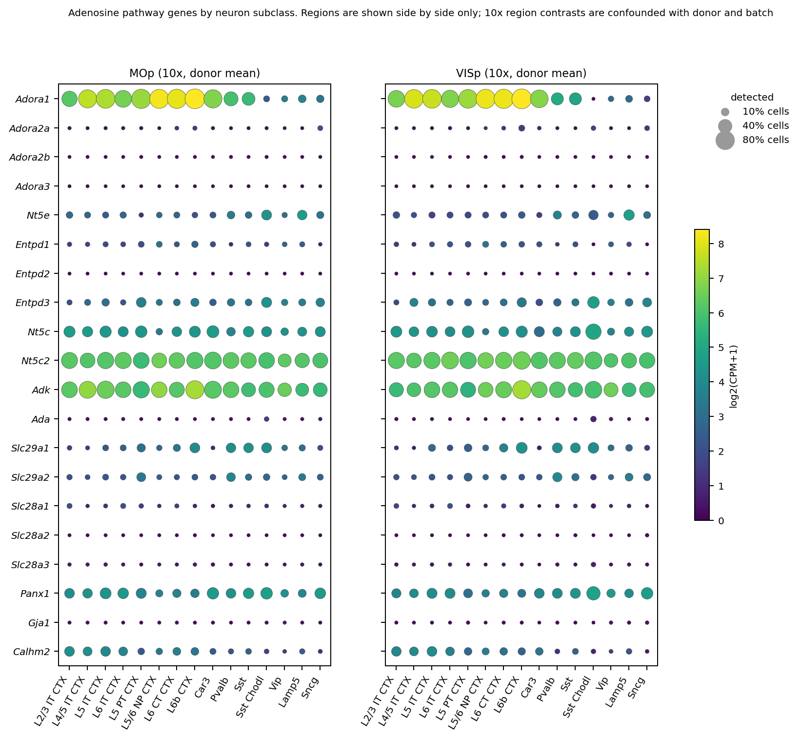
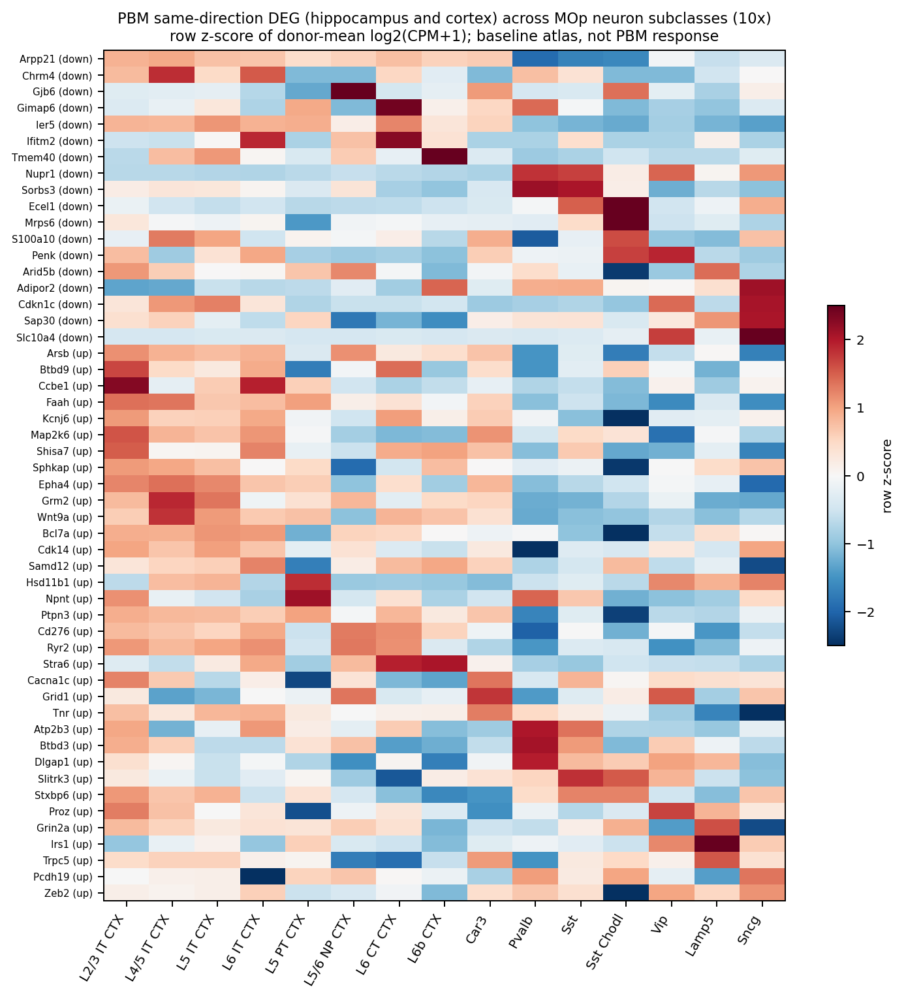

# M1(MOp)과 V1(VISp) 뉴런 유형별 유전자 발현 보고서

작성일 2026-10-15. 목적은 PBM 다음 실험을 고르기 위해 어떤 뉴런 유형이 어떤 유전자를 더 발현하는지, 그리고 같은 뉴런 유형이 M1과 V1에서 어떻게 다른지를 정상 상태 공개 atlas로 정리하는 것이다. 이 보고서의 어떤 결과도 PBM 처리 효과를 측정한 것이 아니다.

그림은 `figures/report_m1v1/`에 PNG(180 dpi)와 PDF로 있다.

## 1. 두 데이터셋과 각각이 답하는 질문

| | 10x RNA-seq (GSE185862, Allen CTX-HPF) | MERFISH (Zhuang-ABCA-1~4) |
|---|---|---|
| 유전자 | 전사체 전체 31,053개 | 1,122개 panel(세포 유형 구분용) |
| 세포 | Snap25-IRES2-Cre;Ai14 RFP+ 정렬 세포(뉴런 99%), 수컷 P57~P59. MOp 123,727개, VISp 29,763개 | 조직 절편의 모든 세포. 네 동물 MOp 98,334개, VISp 80,373개 |
| 동물 구조 | MOp donor 3마리와 VISp donor 3마리가 서로 다르고 library batch도 다름 | 한 동물의 같은 절편에 MOp와 VISp가 함께 있음 |
| 쓸 수 있는 비교 | 같은 영역 안에서 뉴런 유형 간 비교 | 같은 뉴런 유형 안에서 MOp 대 VISp 비교 |
| 쓸 수 없는 비교 | MOp 대 VISp (지역과 donor, batch가 완전히 겹침) | 미토콘드리아와 adenosine 경로 대부분 (panel에 OXPHOS 서브유닛 없음, adenosine은 Adora1과 Adora2a만 있음) |

따라서 질문 A(어떤 뉴런이 어떤 유전자를 더 발현하나)는 10x로, 질문 B(같은 뉴런이 M1과 V1에서 다른가)는 MERFISH로 답했다.

## 2. 방법 요약

### A. 10x 뉴런 유형 marker (`src/rnaseq/pseudobulk_10x.py`, `src/rnaseq/subclass_markers_10x.py`)

- GEO 원본 행렬 전체에서 영역×donor×subclass pseudobulk(원 count 합과 검출 세포 수)를 만들었다. 131개 group의 count 합이 저장된 전체 library 합과 일치함을 확인했다.
- 각 영역 안에서 subclass와 나머지 뉴런을 donor별로 짝지어 log2 CPM 비(fold change)를 구하고 donor 간 t 검정과 BH 보정을 했다.
- MOp marker 기준은 log2FC 1 이상, donor 3마리 모두 같은 방향, subclass 내 검출률 25% 이상, q 0.05 미만이다.
- 재현 기준은 VISp의 다른 donor 3마리(다른 batch)에서 log2FC 1 이상, 3마리 모두 같은 방향, 검출률 25% 이상이다. donor 3마리 t 검정은 자유도가 2라 재현 판정에는 q 기준을 쓰지 않았다.
- 주제 유전자 세트는 결과를 보기 전에 `src/rnaseq/focus_gene_sets.py`에 고정했다. OXPHOS 복합체 I~V는 공식 명명 규칙으로 정했고 핵 유전자와 mt 유전자를 나눴다. adenosine은 수용체, 생성, 제거, 수송, ATP 방출로 나눴다.
- 세트 점수는 해당 세트가 library에서 차지하는 비율을 같은 donor의 전체 뉴런 비율로 나눈 log2 값이다.

### B. MERFISH 동물 짝지은 지역 DEG (`src/merfish/zhuang_paired_deg.py`)

- 동물마다 subclass 안 MOp 평균 빼기 VISp 평균(공식 log2 단위)을 구하고 동물 간 one-sample t 검정(짝지은 검정)을 했다.
- 기준은 3마리 이상, 모든 동물 같은 부호, 차이 0.10 이상, subclass 내 BH q 0.10 미만이다.
- supertype 표준화 결과로 subclass 내부 구성 차이에 따른 것인지도 확인했다.

## 3. 결과

### 3.1 뉴런 유형 marker는 교과서적 패턴을 재현한다 (Fig1)


- MOp에서 marker 4,745개(subclass×gene)를 찾았고 subclass마다 50~87%가 별도 batch의 VISp donor에서 재현됐다. Sst Chodl은 VISp 세포가 34개뿐이라 재현 판정에서 제외했다.
- 상위 marker는 알려진 정체성 유전자와 일치한다. L4/5 IT의 Rorb, L5 PT의 Pou3f1, Npr3, Nefh, L6 CT의 Foxp2, Syt6, Pvalb의 Pvalb, Syt2, Vip의 Vip, Crh, Lamp5의 Ndnf 등이다. 분석 파이프라인의 타당성 근거로 사용한다.
- 전체 표는 `results/rnaseq/whole_transcriptome/subclass_markers/MOp_subclass_markers.csv`이다.

### 3.2 에너지 대사 유전자는 Pvalb와 L5 PT에 집중된다 (Fig3)


- OXPHOS 복합체 I~V의 핵 유전자 세트가 전체 MOp 뉴런 대비 가장 높은 유형은 Pvalb(+0.62~+0.77 log2)와 L5 PT(+0.47~+0.78)이다. donor 3마리 모두 같은 방향이다.
- 810 nm PBM의 1차 수용체로 거론되는 복합체 IV(cytochrome c oxidase)도 같은 순서이다. Pvalb의 marker인 Cox6a2 같은 조직 특이 isoform을 빼고 공통 서브유닛 11개만으로 계산해도 Pvalb +0.57, L5 PT +0.47로 유지된다.
- 미토콘드리아 생합성 조절자 Ppargc1a(PGC-1α)는 Pvalb(log2FC +2.82, 검출 98%), L5 PT(+1.62), Sst(+1.37)에서 높고 VISp donor에서도 같은 방향이다. Ppargc1a는 기존 PBM 22개 가설 panel에 포함된 유전자이다.
- L5 PT는 creatine 완충(Ckmt1 +1.71)과 해당 및 젖산 수송(Slc16a1, Pkm)도 함께 높다.
- Car3과 IT 계열은 OXPHOS가 평균 이하이다.

### 3.3 adenosine 경로는 뉴런 유형별로 나뉜다 (Fig2)



- Adora1은 Glut 뉴런에서 59~98% 세포에 검출되고 GABA 뉴런에서는 낮다(Lamp5, Vip, Sncg 검출 7~13%). Pvalb와 Sst는 중간이다(검출 41~49%).
- Glut 안에서 Adora1이 가장 높은 유형은 L6b(log2FC +1.13), L6 CT(+1.03), L5/6 NP(+0.96)이다. L6 CT와 L6b는 marker 기준을 통과했고 VISp donor에서도 같은 방향이다. 가장 낮은 Glut는 L2/3 IT(−1.17)와 L6 IT(−0.69)이다.
- Adora2a, Adora2b, Adora3는 뉴런에서 거의 검출되지 않는다.
- adenosine 제거 효소 Adk는 L4/5 IT, L6b, L5/6 NP에서 상대적으로 높다. 생성 효소 Nt5e(CD73)는 Lamp5와 Sst Chodl에서 높다. 수송체 Slc29a1(ENT1)은 Sst, Pvalb, L6b, Sst Chodl에서 높다.
- 그림에는 MOp와 VISp를 나란히 보였지만 10x 지역 비교는 donor와 batch에 혼입되어 해석하지 않는다.

### 3.4 PBM 공통 DEG의 기저 발현 분포 (Fig4)



- 기존 PBM에서 해마와 피질 모두 같은 방향으로 변한 52개 중 10x에 있는 유전자를 MOp 뉴런 유형별 기저 발현으로 정렬했다.
- PBM으로 증가한 34개 중 8개가 L2/3 IT에서 기저 발현이 가장 높았다. 나머지 유형은 각각 0~3개였다. tPBM의 빛은 표층에 더 많이 도달하므로 표층 IT 뉴런이 증가 유전자를 주로 담고 있을 가능성이 있다. 다만 기존 PBM DEG는 glia가 섞인 조직 bulk에서 나왔고 이 atlas는 뉴런만 담고 있어, 이 분포는 가설 생성용이다.
- 표는 `results/rnaseq/whole_transcriptome/subclass_markers/pbm_candidates_peak_subclass_MOp.csv`이다.

### 3.5 M1과 V1의 같은 뉴런 유형 비교는 주로 영역 정체성 유전자 차이이다 (Fig5, Fig6)


- 네 동물 짝지은 기준을 통과한 subclass×gene은 496개(유전자 260개)이다. 거의 모두 Glut 뉴런에서 나왔고 L5 ET가 가장 많다(122개). GABA 뉴런은 Pvalb와 Sst에서 1개씩뿐이다.
- 여러 subclass에서 반복된 유전자는 영역 정체성과 투사 관련 유전자이다. MOp 쪽은 Adgrl2(7개 subclass), Scn4b(6개), Nefh, Ppp1r1b, Epha4, Epha7이고 VISp 쪽은 Nr2f1(COUP-TFI, 5개), Adcy8(5개), Satb1, Chn2이다. Nr2f1은 후방 피질 정체성 인자로 알려져 있어 방법의 타당성 근거가 된다.
- 표는 `results/zhuang/paired_deg/`에 있다.

### 3.6 Adora1과 Penk의 지역 차이 (Fig7)


- Adora1은 L2/3 IT에서 MOp가 낮다(네 동물 평균 −0.16, q 0.098, supertype 표준화 후 −0.16). L4/5 IT도 네 동물 모두 음이지만(−0.22) q가 0.16이다. L6 CT의 음의 차이는 이전 점검에서 대부분 supertype 구성 효과였다.
- Penk(PBM 공통 DEG, 감소 방향)은 L2/3 IT에서 MOp가 높다(+0.30, q 0.054, 표준화 후 +0.31). L6 IT도 +0.28이지만 q 0.19이다.
- 두 차이 모두 log2 단위 0.2~0.3 이하로 작다.

### 3.7 MOp와 VISp의 뉴런 구성 차이 (MERFISH 네 동물)

| subclass | MOp 뉴런 중 비율 | VISp 뉴런 중 비율 |
|---|---|---|
| Pvalb | 5.2~6.4% | 3.7~4.3% |
| L5 ET | 4.0~4.2% | 3.7~5.2% |
| L4/5 IT | 11.9~18.0% | 26.4~28.9% |
| L5 NP | 2.4~2.8% | 1.5~2.0% |

에너지 대사가 가장 높은 두 유형 가운데 Pvalb는 네 동물 모두 MOp에 더 많고 L5 ET는 차이가 없다.

## 4. 종합 해석

1. 뉴런 고유 수준에서 PBM의 1차 표적(복합체 IV)과 미토콘드리아 생합성 능력이 가장 큰 유형은 Pvalb와 L5 PT(ET)이다.
2. Adora1은 심층 Glut(L6 CT, L6b, L5/6 NP)에 가장 많고 표층 L2/3 IT와 GABA 뉴런에 적다. L6 CT는 시상으로 투사하므로 피질 adenosine이 시상피질 수면 진동에 관여하는 경로 후보가 된다.
3. 같은 뉴런 유형의 M1 대 V1 차이는 주로 영역 정체성 유전자이고, 측정 가능한 adenosine 관련 차이는 L2/3 IT의 Adora1 감소와 Penk 증가 정도로 작다. 따라서 M1과 V1의 PBM 반응이 다르다면 뉴런 고유 발현보다 구성 차이(MOp의 Pvalb 비율이 높고 L4/5 IT 비율이 낮음), 깊이에 따른 빛 도달, glia와 혈관 같은 비뉴런 요인이 먼저 고려 대상이다.
4. 미토콘드리아와 adenosine 경로 대부분은 MERFISH panel에 없어 지역 비교를 할 수 없었다. 이 공백은 공개 atlas로 채울 수 없고 실험으로 확인해야 한다.

## 5. 다음 실험 후보

| 우선순위 | 질문 | 실험 | 이 보고서의 근거 |
|---|---|---|---|
| 1 | PBM에 먼저 반응하는 세포는 Pvalb와 L5 PT인가 | tPBM 후 M1에서 c-Fos 또는 즉시 초기 유전자와 세포 유형 marker의 동시 FISH(RNAscope). Pvalb, Pou3f1 또는 Fezf2(L5 PT), Cux2(L2/3 IT), Foxp2(L6 CT) | Fig3에서 OXPHOS와 Ppargc1a가 가장 높은 유형. Fig1 marker가 probe 선택 근거 |
| 2 | PBM의 수면 효과는 A1R을 거치는가 | tPBM 전 A1R 길항제(DPCPX) 투여 후 NREM과 SWA 변화가 사라지는지 확인 | Adora1만 뉴런에 높게 발현되고 Adora2a, 2b, 3은 거의 없음(Fig2) |
| 3 | 심층 L6 CT의 A1R이 경로인가 | 1번 FISH에 Adora1 probe를 더해 PBM 후 L6 CT 반응 확인. 이후 L6 CT 선택적 조작(Ntsr1-Cre 등) 고려 | Adora1이 L6 CT와 L6b에서 가장 높음(Fig2) |
| 4 | M1 대 V1 차이가 Pvalb 구성 때문인가 | 같은 자극 조건에서 M1과 V1의 Pvalb c-Fos 비율 비교 | Pvalb 비율이 MOp에서 네 동물 모두 높음(3.7) |
| 5 | 표층 IT가 PBM 유전자 변화를 주도하는가 | 기존 PBM 조직의 표층과 심층 분리 qPCR 또는 공간 전사체 | PBM 증가 유전자가 L2/3 IT 기저 발현에 몰림(Fig4) |

1번이 가장 정보량이 크다. 1번 결과가 어떤 세포 유형을 가리키느냐에 따라 2번과 3번의 조작 대상이 정해진다.

## 6. 한계

- 10x는 Snap25-Cre;Ai14 reporter 수컷의 정렬 뉴런이며 glia와 혈관 세포가 없다. donor 수가 영역당 3마리라 t 검정 검정력이 낮다.
- MERFISH는 B6N 네 동물이고 panel이 세포 유형 구분용이다. sagittal 동물(ABCA-3, -4)의 차이 크기가 coronal 동물보다 2~3배 크다.
- 두 자료 모두 mRNA이다. 복합체 IV 효소 활성이나 A1R 단백질 양과 다를 수 있다.
- 어떤 결과도 PBM 처리 조건을 포함하지 않는다.

## 7. 재현

```bash
.venv/bin/python src/rnaseq/download_geo.py GSE185862_expression_matrix_10x.hdf5
.venv/bin/python src/rnaseq/pseudobulk_10x.py --workers 2
.venv/bin/python src/rnaseq/subclass_markers_10x.py
.venv/bin/python src/merfish/zhuang_paired_deg.py
.venv/bin/python src/report_figures_m1v1.py
```

MERFISH 입력은 `src/merfish/run_zhuang.py`와 `src/merfish/zhuang_supertype_check.py` 실행 결과를 사용한다([Zhuang 보고서](../zhuang/zhuang_report_ko.md)).
