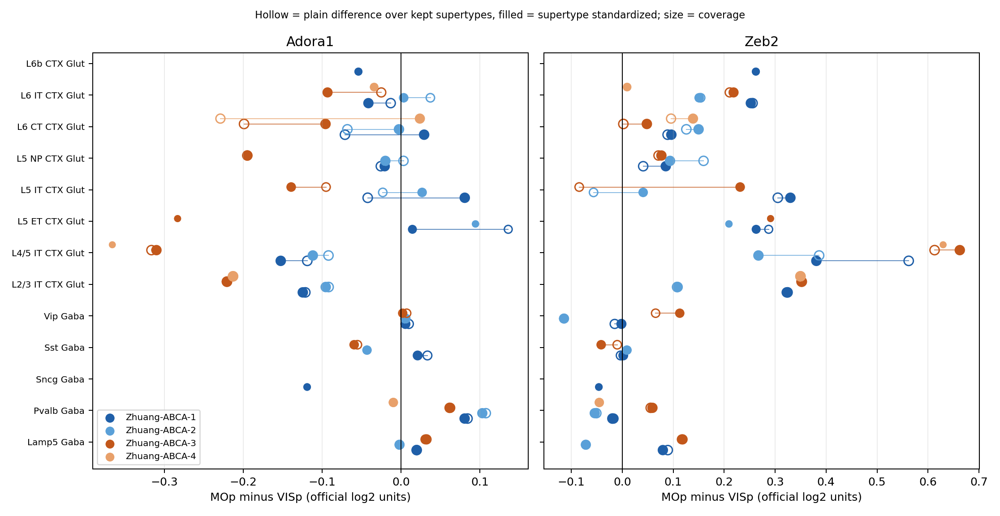

# Zhuang-ABCA MERFISH MOp와 VISp 비교 보고서

작성일 2026-10-15. Zhuang-ABCA-1, -2, -3, -4 네 동물을 모두 분석했다. 같은 날 먼저 ABCA-1과 -2만 분석해 커밋했고(019f246), 이후 네 동물 분석과 supertype 수준 구성 점검을 추가했다.

## 데이터셋

- 출처는 Allen Brain Cell (ABC) Atlas에 공개된 Zhuang lab whole mouse brain MERFISH 자료(Zhang et al., Nature 2023)이다. 공식 S3 release manifest `20250531`을 사용했고 manifest SHA256은 `d1c3f8d8c4e6657dbb8da53e6403f11e6116a125a3682dba9180cc6e998f24cd`이다.
- 동물은 C57BL/6NCrl(B6N) 배경이다. 기존 주 공간 자료인 B6J MERFISH-C57BL6J-638850과 계통이 다르므로 두 자료를 합산하지 않고 B6J의 독립 동물 반복으로 간주하지 않는다.
- ABCA-1과 -2는 coronal 절편, ABCA-3과 -4는 sagittal 절편 series이다. ABCA-4는 표집 범위가 작다.
- 측정 panel은 1,122개 유전자이다. 세포 label은 Allen WMB taxonomy(class, subclass, supertype, cluster)이고 위치는 Allen CCF 2020 parcellation으로 주어진다.
- 사용한 파일은 동물별 `cell_metadata_with_cluster_annotation`, `ccf_coordinates`, `log2` 발현 행렬(h5ad)과 CCF parcellation 대응표이다. 모든 파일은 크기와 공개 MD5를 검증한 뒤 사용했다. 원본(네 동물 약 6.1 GB)은 `input/zhuang/cache/`에 두고 Git에서 제외했으며 live manifest 사본은 `input/zhuang/live_manifest_20250531.json`에 보존했다.
- 이 atlas에는 PBM 처리 조건이 없다. 정상 상태 지역 차이만 기술하며 PBM 반응을 추정하지 않는다.

## 수행한 작업

1. `src/merfish/run_zhuang.py --list`로 manifest를 확인했다. ABCA-1과 -2는 4.24 GB, ABCA-3과 -4는 추가 1.82 GB였다.
2. 첫 실행은 ABCA-1 발현 행렬 로드 단계에서 메모리 초과로 종료됐다(exit 137). 이 log2 행렬은 sparse가 아닌 dense float32 4,167,870 × 1,122 배열(gzip chunk, 압축 해제 시 약 18.7 GB)이며 anndata backed 모드의 fancy indexing이 7 GB RAM을 넘었다.
3. `load_expression`을 수정해 h5py로 저장 chunk 경계에 맞춘 행 블록을 순서대로 읽고 MOp와 VISp 세포 행과 필요한 유전자 열만 남기도록 했다. 반환 값과 세포 순서는 이전 코드와 같고 최대 메모리만 달라진다.
4. 네 동물로 `run_zhuang.py --download`를 실행했다.
5. subclass 내부 구성 차이를 분리하기 위해 `src/merfish/zhuang_supertype_check.py`를 새로 작성해 네 동물에 실행했고, `src/merfish/plot_zhuang_supertype.py`로 요약 그림을 만들었다.
6. 기존 `test_zhuang_logic.py` 9개와 새 `test_zhuang_supertype.py` 3개(순수 구성 차이 제거, 순수 발현 차이 유지, coverage 계산) 테스트를 통과했다.

## 분석 방법 요약

- CCF parcellation에서 MOp와 VISp에 속한 세포만 선택했다.
- 두 영역에 모두 있고 영역별 50개 이상인 subclass 안에서만 MOp 평균 빼기 VISp 평균을 계산했다. 단위는 공식 log2 발현 평균의 차이이며 log2 fold change가 아니다.
- 유전자별 cell-class discordance 점수는 GABA subclass와 Glut subclass에서 차이 부호가 반대로 일관된 정도이다. panel 전체 1,122개 유전자에 대해 계산했다.
- supertype 점검은 subclass마다 두 영역 모두에 20개 이상 있는 supertype만 남긴다. 남긴 세포의 단순 차이(raw_restricted)와 supertype별 차이를 pooled 세포 수로 가중 평균한 값(standardized)을 비교한다. 둘의 차이가 subclass 내부 구성 효과(composition_part)이다. 남긴 supertype이 차지하는 세포 비율을 coverage로 함께 보고한다.
- 동물 수준 p value는 계산하지 않고 동물 간 부호 일치를 보고한다.

## 결과

### 규모

| 동물 | 절편 | MOp 세포 | VISp 세포 | 비교 subclass |
|---|---|---|---|---|
| Zhuang-ABCA-1 | coronal | 48,400 | 38,475 | 23 |
| Zhuang-ABCA-2 | coronal | 21,194 | 15,410 | 19 |
| Zhuang-ABCA-3 | sagittal | 25,856 | 22,864 | 20 |
| Zhuang-ABCA-4 | sagittal | 2,884 | 3,624 | 13 |

### 후보 유전자 측정 범위

탐색 후보 62개 중 12개가 panel에 있다. Adora1, Adora2a, Ccbe1, Cdkn1c, Ecel1, Epha4, Npnt, Penk, Slc10a4, Stxbp6, Trpc5, Zeb2이다. Adk, Nt5e, Entpd1, Slc29a1, Slc29a2, Ada 등 나머지 adenosine 경로 유전자는 측정되지 않았으며 0 발현을 뜻하지 않는다.

### Adora1 subclass 수준

| subclass | ABCA-1 | ABCA-2 | ABCA-3 | ABCA-4 | 같은 부호 |
|---|---|---|---|---|---|
| L2/3 IT CTX Glut | −0.121 | −0.089 | −0.216 | −0.208 | 4/4 음 |
| L4/5 IT CTX Glut | −0.116 | −0.099 | −0.330 | −0.342 | 4/4 음 |
| L5 IT CTX Glut | −0.043 | −0.140 | −0.189 | −0.053 | 4/4 음 |
| L6 CT CTX Glut | −0.070 | −0.069 | −0.196 | −0.198 | 4/4 음 |
| Pvalb Gaba | +0.088 | +0.089 | +0.059 | +0.039 | 4/4 양 |
| Sst Gaba | +0.034 | +0.002 | +0.002 | +0.013 | 4/4 양, 크기 미미 |
| Vip Gaba | +0.008 | −0.010 | +0.018 | 없음 | 불일치 |
| Lamp5 Gaba | +0.017 | −0.018 | +0.030 | 없음 | 불일치 |
| discordance 순위(1,122개 중) | 63 | 545 | 1 | 1 | |

Glut의 음의 방향과 Pvalb의 양의 방향은 네 동물에서 같다. sagittal 두 동물의 Glut 차이(−0.2 내외에서 −0.34)는 coronal 두 동물(−0.07에서 −0.14)보다 2~3배 크다. 방향은 재현되지만 크기는 절편 방향 또는 동물에 따라 달라 하나의 효과 크기로 요약하지 않는다.

### supertype 수준 구성 점검



Adora1

- L2/3 IT와 L4/5 IT의 차이는 supertype 표준화 후에도 유지된다. 구성 효과는 0.00에서 0.03 수준이고 표준화 차이는 L2/3 IT −0.10에서 −0.22, L4/5 IT −0.11에서 −0.37이다. L4/5 IT에서 MOp에 고전적 L4가 적어 생길 수 있는 구성 혼입은 이 결과를 설명하지 못한다. ABCA-4의 L4/5 IT는 coverage가 19%여서 참고용이다.
- L6 CT의 음의 차이는 대부분 supertype 구성 효과이다. 구성 효과는 −0.07에서 −0.25로 네 동물 모두 panel 상위 5% 기준을 넘었고, 표준화 차이는 +0.03, 0.00, −0.10, +0.02로 일관된 방향이 사라진다.
- L5 IT는 표준화 후 부호가 동물마다 갈린다(ABCA-1 +0.08, ABCA-3 −0.14). 구성 효과가 크고 coverage도 75%에서 100% 사이로 달라 판단을 보류한다.
- Pvalb의 양의 차이는 구성 효과가 0.01 미만이고 표준화 후 +0.08, +0.10, +0.06으로 유지된다. ABCA-4는 supertype 1개(coverage 67%)만 남아 −0.01이며 표본이 작다.

Zeb2

- 두 동물 분석 단계에서 구성 혼입을 의심했지만 L2/3 IT(+0.11에서 +0.35)와 L6 IT의 양의 차이는 표준화 후에도 유지된다. L4/5 IT는 ABCA-1과 -2에서 구성 효과가 0.12에서 0.18로 크지만 표준화 후에도 +0.27에서 +0.66이 남는다. L5 IT는 구성 효과가 커서 판단을 보류한다.
- Zeb2의 discordance 순위가 sagittal 동물에서 122위와 188위로 떨어진 것은 GABA 쪽 방향이 동물마다 다르기 때문이다. Glut 쪽 MOp 우세는 네 동물에서 같다.

### 동물 간 재현성

- subclass 내 MOp−VISp 차이의 동물 간 Pearson r은 0.66에서 0.80이고 supertype 표준화 후에도 0.61에서 0.80이다.
- 네 동물 모두에서 계산된 14,586개 strata 중 평균 차이 절댓값 0.05 이상인 1,995개의 81.8%가 네 동물에서 같은 부호이다.
- panel 전체 discordance 점수의 동물 간 Spearman ρ는 0.06에서 0.14이다. 이 점수는 GABA subclass 수가 적어 불안정하므로 후보 순위의 근거로 단독 사용하지 않고 subclass별 차이와 supertype 표준화 결과를 우선 읽는다.

## 해석 요약

Adora1의 정상 상태 MOp−VISp 차이 가운데 네 동물에서 재현되고 supertype 구성으로 설명되지 않는 것은 L2/3 IT와 L4/5 IT의 MOp 저발현, Pvalb의 MOp 고발현이다. L6 CT의 음의 차이는 supertype 구성 차이로 대부분 설명된다. 크기는 log2 단위 0.1에서 0.3 정도로 작고 절편 방향에 따라 크기가 달라진다. 이 결과는 PBM 반응이 아니며 B6N 정상 뇌의 기술 통계이다.

## 산출물

`results/zhuang/`

- `zhuang_report.json` 실행 조건, manifest, 세포 수, 측정 후보
- `candidate_panel_measured_coverage.csv` 후보 62개의 측정 여부
- `within_subclass_region_difference.csv.gz` 동물×subclass×gene의 MOp, VISp 평균과 차이
- `panel_discordance_scores.csv.gz`, `candidate62_discordance_ranks.csv` discordance 점수, 순위, 백분위
- `cross_animal_sign_agreement.csv.gz` subclass×gene별 동물 간 부호 일치
- `Zhuang-ABCA-*_dropped_strata.csv` 제외 strata와 사유

`results/zhuang/supertype/`

- `supertype_standardized_difference.csv.gz` panel 전체 유전자의 raw, restricted, standardized, composition_part, coverage
- `candidate_supertype_decomposition.csv` 측정 후보 12개와 panel 기준 구성 효과 상위 5% 여부
- `supertype_shares_by_region.csv.gz` subclass 안 supertype 비율의 영역별 비교
- `supertype_check_report.json` 실행 조건과 동물 간 상관

`figures/zhuang/`

- `zhuang_candidate_by_subclass.png`, `zhuang_panel_discordance_null.png`, `zhuang_supertype_standardized.png`

## 한계

- 동물 4마리의 기술 통계이며 효과 크기 추정이나 유의성 검정이 아니다. ABCA-4는 MOp와 VISp 세포가 적어 일부 subclass가 비어 있다.
- B6N 계통이며 B6J 주 분석과 합산하지 않는다.
- supertype 표준화는 두 영역 모두에 표집된 supertype만 다룬다. cluster 수준 구성, 층 깊이, 절편 위치에 따른 차이는 아직 분리하지 않았다.
- coronal과 sagittal 사이의 크기 차이가 생물학적 차이인지 절편 방향과 세포 분절의 기술적 차이인지 구분하지 못했다.
- PBM 처리 조건이 없어 PBM 반응을 측정하지 않는다.

## 재현

```bash
.venv/bin/python src/merfish/run_zhuang.py --list --animals Zhuang-ABCA-1 Zhuang-ABCA-2 Zhuang-ABCA-3 Zhuang-ABCA-4
.venv/bin/python src/merfish/run_zhuang.py --download --animals Zhuang-ABCA-1 Zhuang-ABCA-2 Zhuang-ABCA-3 Zhuang-ABCA-4
.venv/bin/python src/merfish/zhuang_supertype_check.py --animals Zhuang-ABCA-1 Zhuang-ABCA-2 Zhuang-ABCA-3 Zhuang-ABCA-4
.venv/bin/python src/merfish/plot_zhuang_supertype.py
.venv/bin/python -m pytest -q src/merfish/test_zhuang_logic.py src/merfish/test_zhuang_supertype.py
```

`--list`도 `results/zhuang/zhuang_report.json`을 manifest 확인 상태로 덮어쓴다. 결과를 보존하려면 `--download` 실행 뒤에 다시 `--list`를 실행하지 않는다.
