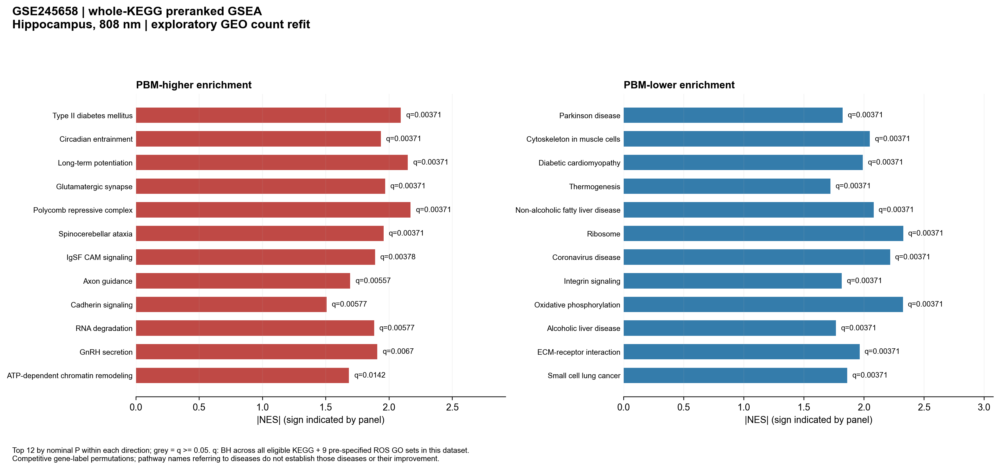
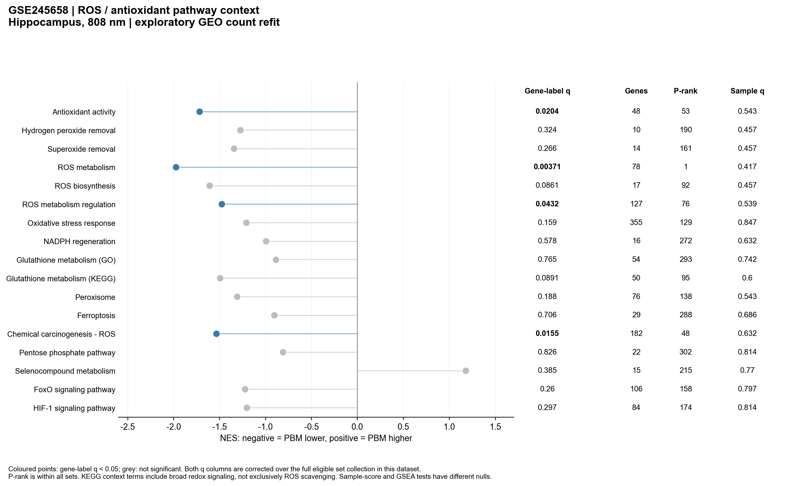
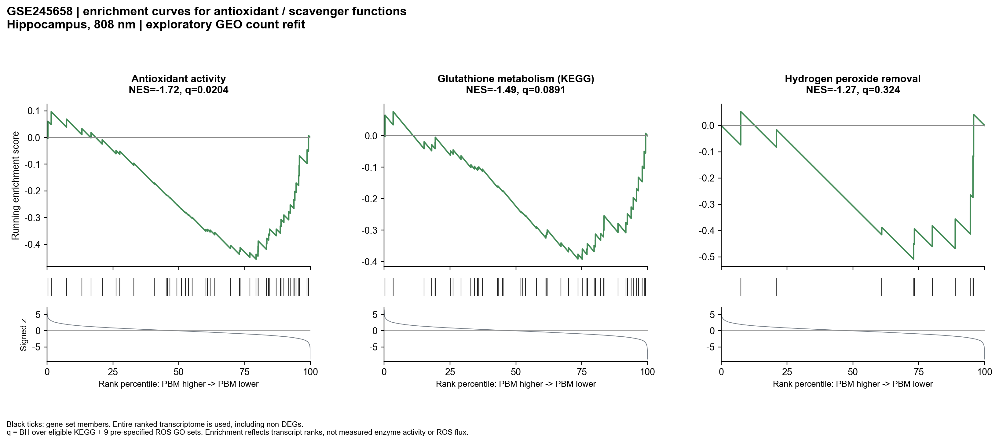
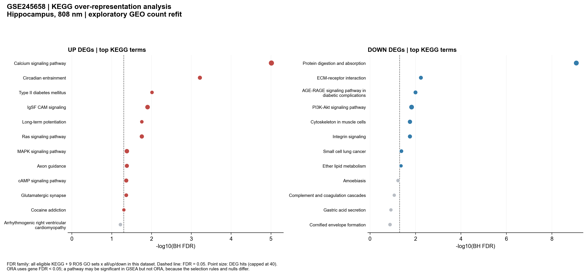
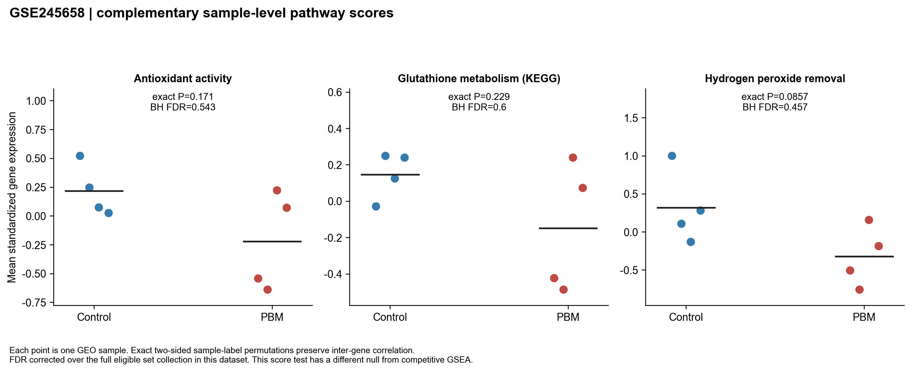
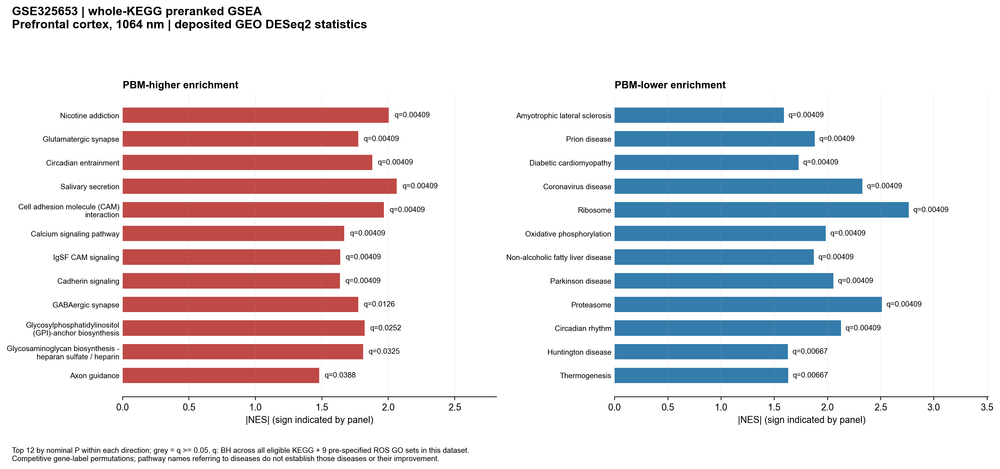
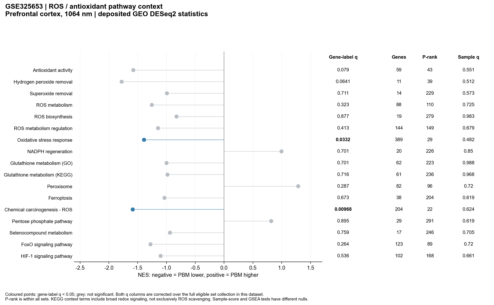
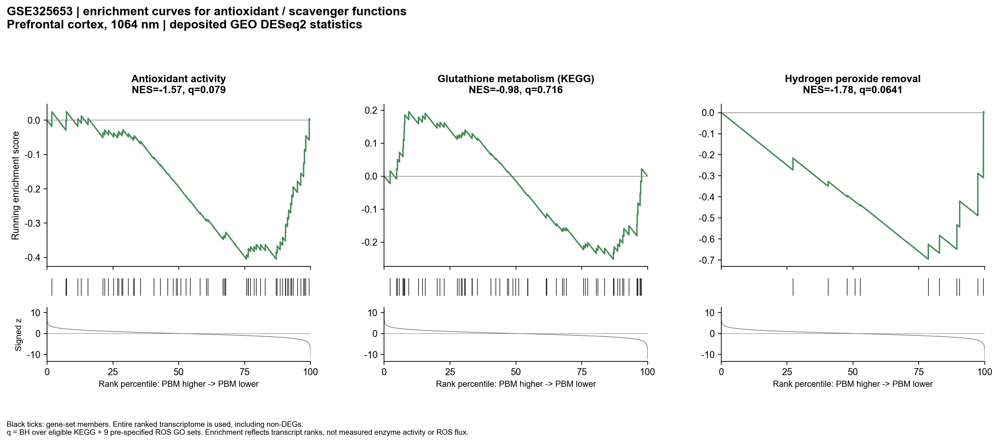
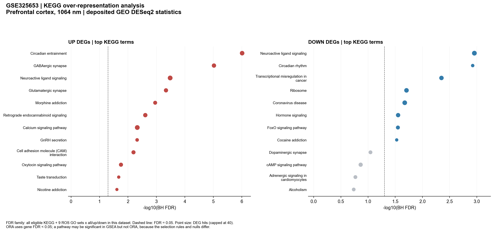
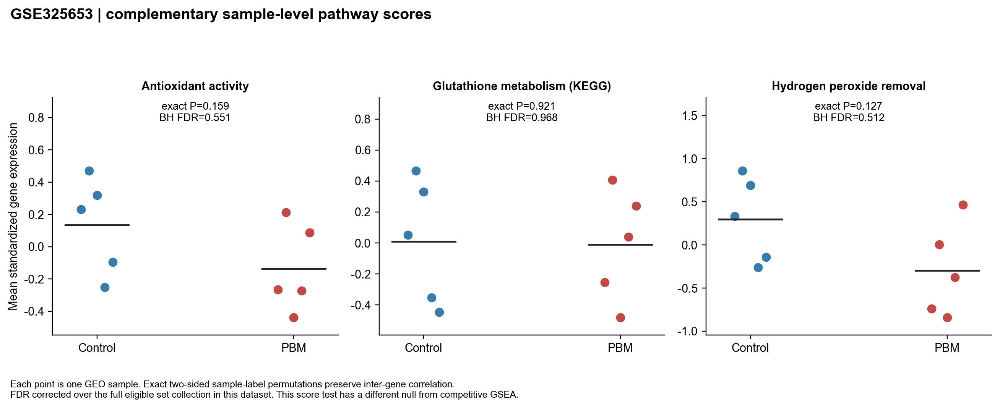

# 데이터셋별 전체 KEGG 및 ROS·항산화 경로 분석

기존 저장소의 `ROS_scavenger_20261103` 브랜치에는 ROS 기능군 10개의 [GSEA 요약 그림](../ros_scavenger/figures/fig06_ROS_GSEA.png), [기존 ORA 그림](../ros_scavenger/figures/fig07_existing_ORA_FDR.png), [표본 단위 score 그림](../ros_scavenger/figures/fig08_sample_level_pathway_scores.png)이 있었다. **전체 KEGG 경로를 비교하는 데이터셋별 그림은 없어 이번에 추가했다.** 그림의 실제 폰트는 Arial이며 PNG·PDF·SVG로 저장했다.

## 핵심 해석

- **GSE245658(해마):** 전체 경로를 포함한 검정에서 antioxidant activity는 감소 방향이며 GSEA FDR<0.05다. ROS metabolism과 그 regulation도 감소 방향의 탐색적 신호다. 다만 직접적인 hydrogen peroxide/superoxide removal 기능군과 KEGG glutathione metabolism은 유의하지 않다.
- **GSE325653(전전두피질):** antioxidant activity와 hydrogen peroxide removal의 NES는 음수지만, 이번 전체 경로 검정에서는 FDR≥0.05다. Oxidative stress response는 감소 방향의 GSEA 신호가 있고, KEGG glutathione metabolism은 유의하지 않다.
- **두 연구 모두 KEGG chemical carcinogenesis–ROS는 감소 방향 GSEA 신호가 있다.** 이 집합은 신호 전달·대사·호흡사슬 등을 함께 포함하는 넓은 경로이며 직접적인 scavenger 경로가 아니다. 암 발생·치료 효과나 실제 ROS 감소로 해석하지 않는다.
- 표본 단위 평균 경로 score 검정은 전체 경로 보정 후 유의한 항목이 없다. 따라서 gene-label GSEA 결과를 생체 항산화 능력 저하 또는 ROS 생성량의 변화로 확정할 수 없다.

여기서 ‘영향력’은 **전사체 순위에서의 상대적 enrichment(NES), 전체 경로 중 위치, FDR, 기여 유전자 범위**로 제시한다. 인과적 기여율·ROS 제거 능력·생체 내 flux의 크기를 계산한 것은 아니다.

## 비교 조건과 통계 출처

| Dataset | 비교 | 시료 | 전체 통계 |
|---|---|---|---|
| GSE245658 | 해마 808 nm, 5xFAD+light / 5xFAD | 4 / 4 | 기존 ROS 분석에서 저장한 GEO 추정 count 반올림 기반의 새 두 군 PyDESeq2 fit |
| GSE325653 | 전전두피질 1064 nm, 저산소+PBM / 저산소 | 5 / 5 | 원 GEO 제출 DESeq2 통계; FPKM을 count로 재계산하지 않음 |

원 GEO 파일·시료 확인, A의 소수 count·길이 보정 부재·새 fit의 한계, B의 기존 DEG 누락 21개는 [기존 상세 보고서](../ros_scavenger/ROS_scavenger_report_ko.md)에 설명돼 있다. 이번 분석은 이미 확보한 전체 통계와 순위 파일을 재사용했다. 조직·파장·질환 배경이 함께 다르므로 두 연구의 차이를 순수한 피질/해마 또는 파장 효과로 분해하지 않는다.

## 전체 경로에서 ROS 기능군의 위치

아래 FDR는 데이터셋별 **분석 가능한 전체 KEGG + 사전 지정 ROS GO 9개**에 대한 BH 값이다. P-rank는 해당 전체 집합에서 nominal P 순위이며 작은 값이 더 강한 통계적 enrichment다. 두 연구를 함께 보정한 민감도 값과 KEGG만 보정한 값도 Excel/CSV에 저장했다.

| Dataset | ID | 기능군 | NES | GSEA BH FDR | P-rank | Genes | Leading edge | Sample BH FDR |
|---|---|---|---|---|---|---|---|---|
| GSE245658 | GO:0072593 | ROS metabolism | -1.974 | 0.00371 | 1 | 78 | 35 | 0.4174 |
| GSE245658 | mmu05208 | Chemical carcinogenesis - ROS | -1.534 | 0.01547 | 48 | 182 | 80 | 0.6316 |
| GSE245658 | GO:0016209 | Antioxidant activity | -1.717 | 0.02041 | 53 | 48 | 22 | 0.5434 |
| GSE245658 | mmu00480 | Glutathione metabolism (KEGG) | -1.494 | 0.08906 | 95 | 50 | 21 | 0.6 |
| GSE245658 | GO:0019430 | Superoxide removal | -1.343 | 0.2663 | 161 | 14 | 6 | 0.4571 |
| GSE245658 | GO:0042744 | Hydrogen peroxide removal | -1.273 | 0.3241 | 190 | 10 | 7 | 0.4571 |
| GSE325653 | mmu05208 | Chemical carcinogenesis - ROS | -1.585 | 0.009684 | 22 | 204 | 79 | 0.6238 |
| GSE325653 | GO:0042744 | Hydrogen peroxide removal | -1.777 | 0.06409 | 39 | 11 | 6 | 0.5124 |
| GSE325653 | GO:0016209 | Antioxidant activity | -1.575 | 0.07903 | 43 | 59 | 25 | 0.5508 |
| GSE325653 | GO:0072593 | ROS metabolism | -1.253 | 0.323 | 110 | 88 | 24 | 0.7254 |
| GSE325653 | GO:0019430 | Superoxide removal | -0.9921 | 0.7112 | 229 | 14 | 7 | 0.5728 |
| GSE325653 | mmu00480 | Glutathione metabolism (KEGG) | -0.9821 | 0.716 | 236 | 61 | 13 | 0.9676 |

기존 ROS 한정 분석의 FDR는 10기능군×2연구=20검정에 대한 값이다. **이번 FDR와 같은 값이 아니다.** GO의 antioxidant activity는 A에서 이번에도 유의하지만, B에서는 기존 ROS 한정 분석의 유의성이 전체 KEGG를 포함한 검정으로 유지되지 않는다. BH는 검정 수뿐 아니라 전체 P값 분포에도 영향을 받으며, 데이터셋별/두 연구 합산 보정과 Monte Carlo 표본 수·seed도 달라 단순히 ‘검정이 많아져 FDR가 항상 커진다’고 해석하지 않는다.

GO antioxidant activity는 peroxidase·환원효소 등도 포함한다. Ptgs1/2 같은 prostaglandin 대사 유전자까지 들어갈 수 있으므로 전체를 순수한 직접 scavenger 집합이라고 부르지 않는다. 제거 기능 자체는 별도의 H2O2 catabolism 및 superoxide removal로 구분했다.

## GSE245658: 데이터셋별 결과

분석된 KEGG는 **327개**, ROS GO는 9개로 GSEA family는 336개다. 순위 유전자 수는 13,784개다. 전체 확장 family에서 gene-label GSEA FDR<0.05인 검정은 79개이며, KEGG만 보정했을 때 유의한 KEGG는 76개다. 서로 겹치는 경로를 독립적인 현상 수로 세지 않는다.

**Antioxidant activity:** NES -1.717, FDR 0.02041, P 순위 53/336. |NES|는 전체 집합의 87.8 percentile(절대 NES가 더 작은 집합의 비율)에 해당한다. 48개 matched gene 중 leading edge는 22개다. 이 크기·순위는 relative enrichment이며 설명 분산이나 항산화 능력의 백분율이 아니다.

비교를 위해 oxidative phosphorylation은 NES -2.324/FDR 0.00371, ribosome은 NES -2.327/FDR 0.00371다. 항산화 집합보다 nominal P가 작은 경로는 52개 있다. 따라서 항산화 축만이 유일하거나 가장 강한 전사체 반응이라고 보지 않는다.

**KEGG glutathione metabolism:** NES -1.494, nominal P 0.02518, 전체 family FDR 0.08906; KEGG-only FDR 0.09049. 이 경로는 FDR<0.05가 아니다.

### 기여 유전자

Antioxidant activity의 leading edge: **Ptgs1, Srxn1, Cat, Gstk1, Gpx7, Gstt1, Apoe, Sod1, Nxn, Ptges, Prdx1, Txndc17, Mgst1, Mgst3, Nqo1, Clic1, Prdx6, Prdx4, Sod3, Gpx1, Cp, Gpx8**.

전체 leading edge 목록과 각 gene log2FC/FDR는 [`GSE245658/ROS_leading_edge_gene_statistics.csv`](results/GSE245658/ROS_leading_edge_gene_statistics.csv)에 있다. Leading edge 포함이 gene-level FDR<0.05나 인과적인 driver임을 뜻하지 않는다. GSEA는 많은 작은 변화를 합칠 수 있어, 유의한 DEG가 적어도 pathway enrichment가 나타날 수 있다.

### KEGG ORA와 표본 단위 검정

ORA는 gene FDR<0.05의 전체/up/down DEG를 사용했고, 1008개 경로×방향 검정 전체에 BH를 적용했다. 31개 검정이 유의하다. 기능군 10개만 분석한 기존 focused ORA와 보정 family가 달라 기존 수치를 덮어쓰지 않았다.

표본 score 검정에서 FDR<0.05인 항목은 0개다. Antioxidant activity raw exact P=0.1714, BH FDR=0.5434다. 이 검정은 유전자 간 상관을 보존하지만 평균 표준화 발현 차이를 검정하는 별도 self-contained 가설이며 competitive GSEA와 귀무가설이 다르다. 둘을 같은 검정의 통과/실패로 부르지 않는다.

사전 지정 ROS/항산화 context 항목의 ORA는 모두 다중검정 후 유의하지 않다.

## GSE325653: 데이터셋별 결과

분석된 KEGG는 **338개**, ROS GO는 9개로 GSEA family는 347개다. 순위 유전자 수는 15,914개다. 전체 확장 family에서 gene-label GSEA FDR<0.05인 검정은 34개이며, KEGG만 보정했을 때 유의한 KEGG는 33개다. 서로 겹치는 경로를 독립적인 현상 수로 세지 않는다.

**Antioxidant activity:** NES -1.575, FDR 0.07903, P 순위 43/347. |NES|는 전체 집합의 89.6 percentile(절대 NES가 더 작은 집합의 비율)에 해당한다. 59개 matched gene 중 leading edge는 25개다. 이 크기·순위는 relative enrichment이며 설명 분산이나 항산화 능력의 백분율이 아니다.

비교를 위해 oxidative phosphorylation은 NES -1.983/FDR 0.004088, ribosome은 NES -2.763/FDR 0.004088다. 항산화 집합보다 nominal P가 작은 경로는 42개 있다. 따라서 항산화 축만이 유일하거나 가장 강한 전사체 반응이라고 보지 않는다.

**KEGG glutathione metabolism:** NES -0.982, nominal P 0.487, 전체 family FDR 0.716; KEGG-only FDR 0.7219. 이 경로는 FDR<0.05가 아니다.

### 기여 유전자

Antioxidant activity의 leading edge: **Gstp2, Mgst2, Apoe, Gsto2, Prdx1, Epx, Mgst1, Prdx2, Gpx6, Ltc4s, Txnrd2, Gpx3, Prdx4, Gstp1, Ccs, Nqo1, Ptges, Gsr, Sod1, Txnrd3, Gpx4, Gpx1, Gstt2, Ptgs1, Txnrd1**.

전체 leading edge 목록과 각 gene log2FC/FDR는 [`GSE325653/ROS_leading_edge_gene_statistics.csv`](results/GSE325653/ROS_leading_edge_gene_statistics.csv)에 있다. Leading edge 포함이 gene-level FDR<0.05나 인과적인 driver임을 뜻하지 않는다. GSEA는 많은 작은 변화를 합칠 수 있어, 유의한 DEG가 적어도 pathway enrichment가 나타날 수 있다.

### KEGG ORA와 표본 단위 검정

ORA는 gene FDR<0.05의 전체/up/down DEG를 사용했고, 1041개 경로×방향 검정 전체에 BH를 적용했다. 47개 검정이 유의하다. 기능군 10개만 분석한 기존 focused ORA와 보정 family가 달라 기존 수치를 덮어쓰지 않았다.

표본 score 검정에서 FDR<0.05인 항목은 0개다. Antioxidant activity raw exact P=0.1587, BH FDR=0.5508다. 이 검정은 유전자 간 상관을 보존하지만 평균 표준화 발현 차이를 검정하는 별도 self-contained 가설이며 competitive GSEA와 귀무가설이 다르다. 둘을 같은 검정의 통과/실패로 부르지 않는다.

ROS context에 지정한 항목 중 ORA 유의 결과:

| set_name | direction | k | K | fold_enrichment | FDR_all_sets_directions_per_dataset |
|---|---|---|---|---|---|
| FoxO signaling pathway | down | 12 | 123 | 2.88 | 0.02824 |

FoxO 같은 넓은 신호 경로의 ORA를 직접적인 scavenger 활성의 증거로 해석하지 않는다.

## 분석 방법과 해석 범위

1. KEGG의 최신 마우스 pathway 목록과 gene–pathway link를 직접 내려받았다. 368개 경로를 catalog에 보관하고, 발현/통계 universe와 교차한 크기가 15–500인 KEGG만 검정했다. 전체 대사 map이나 작은 경로가 제외된 이유는 `set_coverage.csv`에 남겼다. ROS GO 9개는 기존 QuickGO snapshot을 그대로 사용하고 크기 5–500으로 검정했다. 이는 전체 GO catalog 분석이 아니라 사전에 정의한 ROS 기능군을 KEGG에 추가한 분석이다.
2. KEGG Entrez를 저장된 공식 mouse gene-name 목록의 primary symbol로 매핑했다. 유효하고 고유한 심볼만 있는 기존 순위 universe를 유지한다. 모든 alias를 임의로 합치지 않았으며 매핑되지 않은 ID와 matched size는 audit에 남겼다. 명칭이 바뀐 유전자 등의 매핑 한계가 있다.
3. 전체 순위는 `sign(log2FC) × normal_inverse_survival(P/2)`이며 DEG로 자르지 않았다. NES<0은 PBM에서 감소 쪽 순위에 상대적으로 몰린다는 뜻이다. 제거와 생성 유전자가 섞인 경로의 음의 NES는 순 ROS 농도 감소나 항산화 기능 향상을 뜻하지 않는다.
4. Weighted GSEA 지수 1, streaming gene-label null을 사용했다. 전체 catalog에는 크기별 10,000회, 사전 지정 ROS 관련 set의 matched size에는 50,000회 순열을 계산했다. 동일한 크기의 집합은 같은 gene-label null 분포를 가지므로 null을 재사용한다. seed는 `20261104 + crc32(dataset:K)`다. 같은 부호 null의 평균 |ES|로 NES를 계산하고, tail P에는 +1을 적용했다. nominal P의 Monte Carlo Wilson 구간도 보관했다. 이는 생물학적 신뢰구간이 아니다.
5. 1차 GSEA 보정은 데이터셋별 전체 eligible KEGG+ROS GO의 nominal P에 대한 BH다. KEGG-only와 두 데이터셋 전체 합산 보정도 민감도로 저장했다. GSEA의 pooled-NES FDR q와는 다른, 명시적인 BH 보정이다. p순위 동률이 있을 수 있으며 permutation 해상도 이하로 순위를 세밀하게 단정하지 않는다.
6. KEGG ORA는 finite gene FDR의 전체 universe에서 FDR<0.05 전체/up/down을 각각 hypergeometric 우측검정했고 데이터셋별 전체 set×3방향에 BH를 적용했다. DEG 수나 pathway 이름만으로 GSEA 방향을 판정하지 않았다.
7. 보완적인 표본 score는 A log2(normalized estimated count+1), B log2(FPKM+1)에서 각 유전자를 전체 시료 기준 z-standardization한 후 유전자 평균으로 정의했다. A 70개/B 252개의 모든 균형 시료 라벨 배정을 열거한 양측 exact P에 데이터셋별 전체 경로 BH를 적용했다. 원 시료의 batch/짝지음 정보가 확인되지 않아 독립 시료를 가정한다. 작은 n에서 비유의 결과가 효과 부재나 충분한 검출력을 뜻하지는 않는다.

**판단:** 해마에는 항산화 주석 집합의 상대적 감소라는 탐색적 전사체 신호가 있다. 전전두피질은 ROS/스트레스의 넓은 경로 신호는 있지만, 직접적인 scavenger·antioxidant 경로가 전체 경로 보정에서 명확히 유의하다고 하기 어렵다. 두 연구 모두 glutathione metabolism 증가·감소가 통계적으로 확증됐다는 결론은 지지하지 않는다. 단백질 활성·GSH/GSSG·ROS 측정과 연결하기 전에는 기능적 영향의 크기로 번역하지 않는다.

## 파일

- [통합 Excel](results/Dataset_pathway_GSEA_KEGG.xlsx): 모든 경로, ROS 비교, ORA, leading edge.
- [`results/ROS_pathway_comparison.csv`](results/ROS_pathway_comparison.csv): NES·각 FDR family·전체 순위·leading edge 수·표본 score.
- `results/GSE245658/`, `results/GSE325653/`: 각 데이터셋 전체 결과와 set coverage.
- `results/gene_set_catalog.csv`, `kegg_gene_mapping.csv`: 경로 정의와 매핑.
- `results/provenance.json`, `../input/pathway_overview/source_manifest.json`: 입력 해시와 다운로드 근거.
- `figures/`: 각 데이터셋 5개씩, 총 10개 그림을 PNG·PDF·SVG로 저장.
- [재실행 방법](README.md).

이번 전체 경로 분석은 기존 ROS 한정 분석과 구분해 보관한다. 코드·입력·결과 및 Arial 그림은 GitHub의 `ROS_scavenger_20261103` 브랜치에 함께 저장한다.
