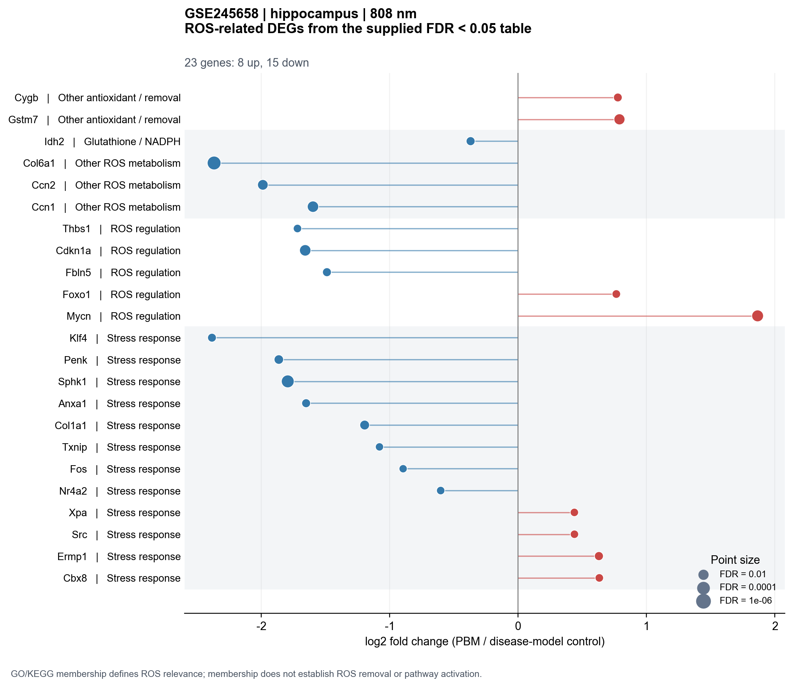
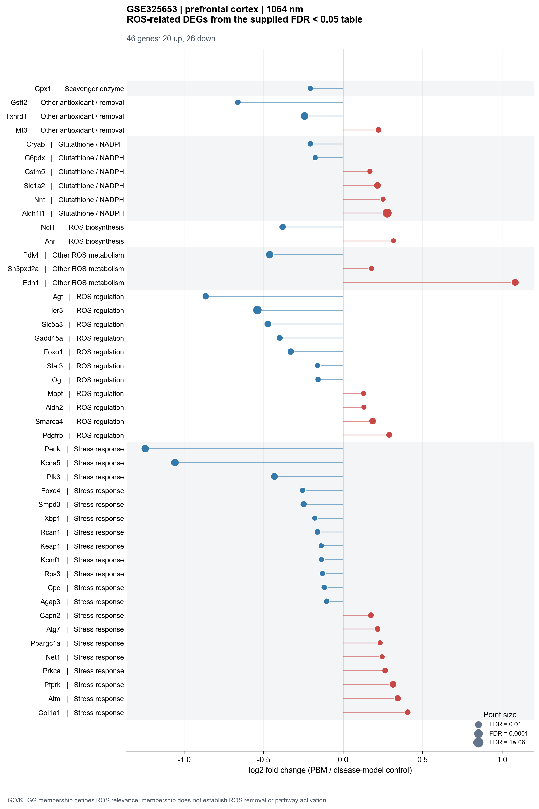
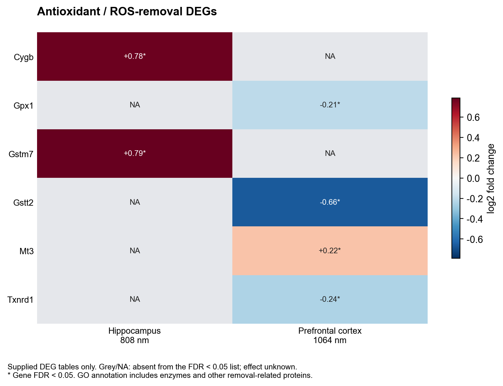
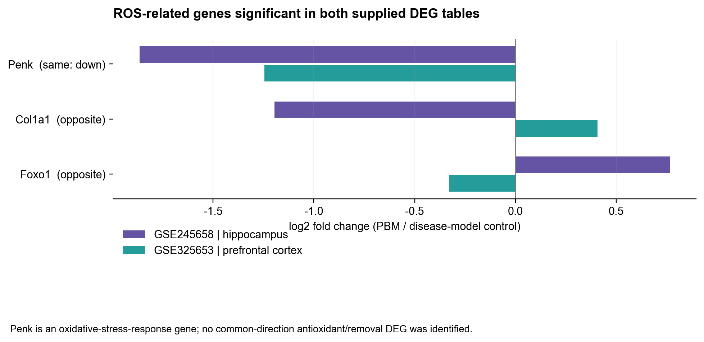
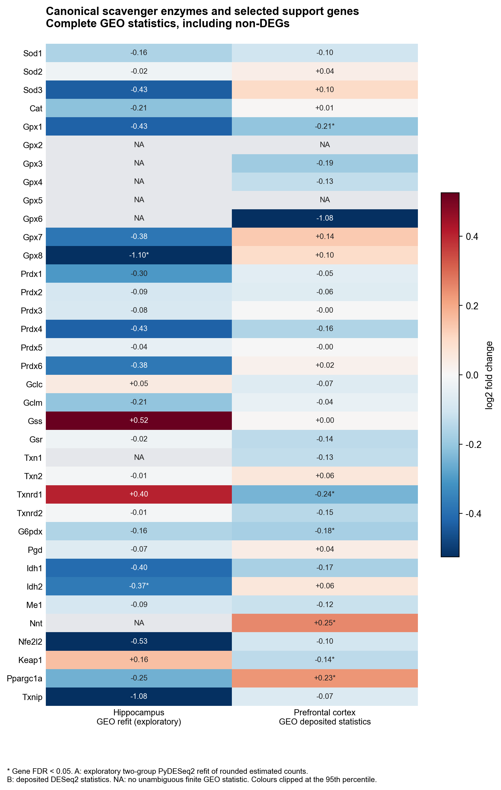
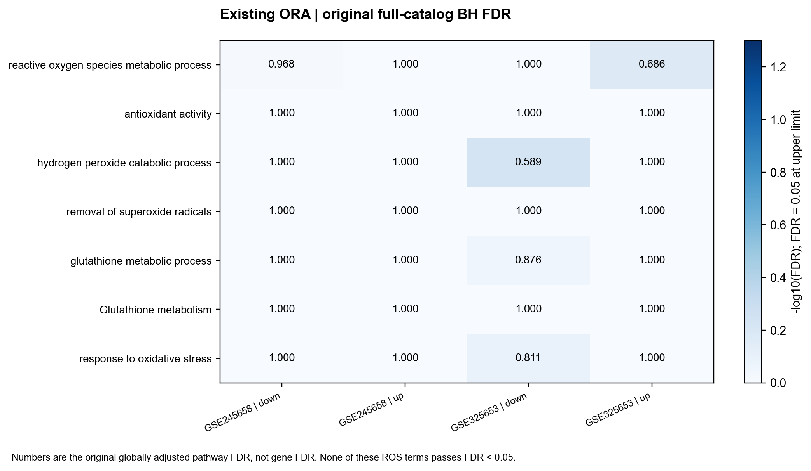
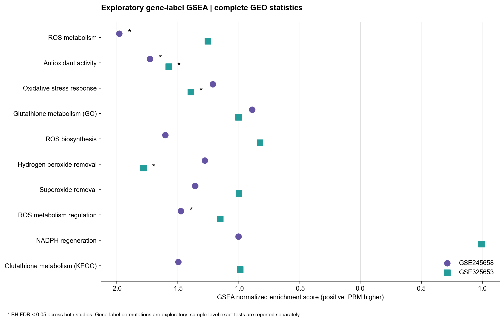
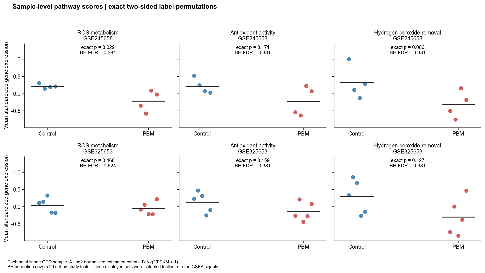

# ROS 생성·제거 및 scavenger 분석

> 전체 KEGG와 비교하는 데이터셋별 후속 결과는 [새 보고서](../pathway_overview/Dataset_pathway_report_ko.md)와 [그림 목록](../pathway_overview/README.md)에 있다. 이 보고서의 GSEA는 ROS 한정 20검정이며, 전체 경로 보정 결과와 구분한다. Antioxidant activity는 전체 경로 범위에서 해마 FDR 0.0204, 전전두피질 FDR 0.0790이다.

분석 브랜치: `ROS_scavenger`. 모든 그림은 실제 **Arial**을 사용해 PNG·PDF·SVG로 저장했다. PDF에는 Arial을 임베딩하고 SVG는 글리프를 path로 변환했다.

## 핵심 결과

- **기존 제공 DEG 표 기준:** 해마 ROS 관련 23개(up 8, down 15), 전전두피질 46개(up 20, down 26).
- **공통 방향은 Penk down 1개다. Penk는 산화스트레스 반응 주석에 속하며, 직접적인 scavenger 효소로 분류하지 않았다.** Antioxidant/removal 기능군의 공통 방향 DEG는 없다. Col1a1과 Foxo1은 반대 방향이다.
- 기존 전역 catalog ORA와 새 GEO 기반 focused ORA에는 FDR<0.05인 ROS 항목이 없다. 전체 순위를 쓰는 탐색적 GSEA에서는 6개 set×study 검정이 BH FDR<0.05이며, antioxidant activity는 두 연구 모두 감소 방향이다.
- 유전자 간 상관을 보존하는 **표본 단위 경로 score 정확 순열검정은 20개 검정 전체에서 FDR<0.05인 항목이 없다.** 서로 다른 귀무가설을 검정하므로 GSEA를 반증하는 결과는 아니지만, 경로 변화가 견고하게 확증됐다고 표현하기에는 근거가 부족하다.
- 원 GEO와 기존 DEG 표는 완전히 같지 않다. 전전두피질 GEO 전체 통계에는 기존 파일에서 빠진 유의 유전자 21개가 있고, 이 중 ROS catalog에 속한 것은 **Ptgs1, Ptgs2, Tacr1**다. 해마 재분석은 원 DEG를 그대로 재현하는 분석이 아니라 독립적인 탐색적 재계산이다. 아래에서 출처를 구분한다.

## 1. 비교 조건 및 원 GEO 확인

| 구분 | GSE245658 | GSE325653 |
|---|---|---|
| 조직 / 파장 | hippocampus / 808 nm | prefrontal cortex / 1064 nm |
| 처리 / 대조 | 5xFAD+light / 5xFAD | hypobaric hypoxia+PBM / hypobaric hypoxia |
| GEO 시료 | 5xFAD+L_HP rep1–4 / 5xFAD_HP rep1–4 | intervention01–05 / control01–05 |
| 처리 / 대조 시료 수 | 4 / 4 | 5 / 5 |
| 원본 파일 | all.genes.expression.annot.LT.txt.gz | raw_counts.xlsx |
| 실제 내용 | FPKM과 소수 포함 추정 count 열 | FPKM, 전체 DESeq2 log2FC·P·q |
| 경로용 통계 | 두 군만 포함한 새 PyDESeq2 fit | 제출자의 전체 DESeq2 통계 |

[GSE245658](https://www.ncbi.nlm.nih.gov/geo/query/acc.cgi?acc=GSE245658), [GSE325653](https://www.ncbi.nlm.nih.gov/geo/query/acc.cgi?acc=GSE325653)의 Series 및 GSM metadata를 직접 읽어 조건을 확인했다. 본 분석의 원문 snapshot·다운로드 URL·SHA256은 [`../input/ros_geo/`](../input/ros_geo/)에 보관했다. 시료 메타데이터 요약은 [`geo_sample_metadata.csv`](results/geo_sample_metadata.csv)다. 등록된 반복 시료를 독립 시료로 취급했으며, 확인되지 않은 batch·짝지음·동물 공변량을 임의로 만들지 않았다.

GSE245658의 count 열 중 12.67%가 소수다. 이름만 보고 원시 정수 read count라고 부르지 않았다. 새 분석은 nearest-integer rounding(half-to-even), ≥10 count가 8개 중 ≥4개 시료에 있는 유전자만 포함, `~condition`, PBM/control contrast, PyDESeq2 0.5.4를 사용했다. WT 및 다른 조직은 제외했다. transcript length offset이 없어 이 재계산에는 근사 가정이 있다. GEO metadata의 원 논문 DEG 기준은 adjusted P<0.05 및 |log2FC|>1이지만, 이번 요청은 **저장소의 FDR<0.05 기준 DEG**를 분석하며 원 논문의 fold-change cutoff를 추가하지 않았다.

GSE325653 파일의 시료별 값은 99.19%가 비정수이며 GSM 설명도 FPKM이라고 명시한다. **FPKM에 DESeq2를 새로 적합하지 않았다.** 전체 통계는 원본의 `log2FoldChange`, `p-value`, `q-value`를 사용했다. B의 기존 998개 DEG는 GEO 통계와 FDR가 일치하고 log2FC는 반올림 오차 ≤0.00005 이내다. 그러나 GEO 전체에서는 q<0.05가 1,019개여서, 기존 목록은 전체 유의 유전자를 모두 담지 않는다. 누락 이유는 이 자료만으로 확인되지 않는다.

## 2. ROS 정의와 중복 처리

QuickGO의 **Mus musculus(10090) 단백질 GO 주석**을 사용했다. GO root와 `is_a/part_of` descendants를 조회하고 NOT 주석은 제외했다. IEA를 포함하며 원 evidence code·reference·annotation date를 모두 보관했다. 반대 방향의 조절 관계를 직접적인 생성·제거와 혼동하지 않도록 regulation은 별도 root로 다뤘다. KEGG 마우스 glutathione metabolism을 추가해 NADPH 공급을 포함했다. 정의는 기능군 10개이며 결과의 P값에 따라 기능군을 추가·삭제하지 않았다.

| set_name | label | root_id | mouse_symbols |
|---|---|---|---|
| ros_metabolism | ROS metabolism | GO:0072593 | 108 |
| antioxidant_activity | Antioxidant activity | GO:0016209 | 78 |
| oxidative_stress_response | Oxidative stress response | GO:0006979 | 436 |
| glutathione_metabolism | Glutathione metabolism (GO) | GO:0006749 | 73 |
| ros_biosynthesis | ROS biosynthesis | GO:1903409 | 25 |
| hydrogen_peroxide_catabolism | Hydrogen peroxide removal | GO:0042744 | 14 |
| superoxide_removal | Superoxide removal | GO:0019430 | 16 |
| ros_metabolism_regulation | ROS metabolism regulation | GO:2000377 | 168 |
| nadph_regeneration | NADPH regeneration | GO:0006740 | 21 |
| kegg_glutathione | Glutathione metabolism (KEGG) | mmu00480 | 73 |

Canonical scavenger enzyme 참고 패널은 **Sod1/2/3, Cat, Gpx1–8, Prdx1–6**이다. GO antioxidant activity는 peroxidase와 보조 환원효소 등도 포함하므로 이 전체를 ‘직접 ROS 제거 효소’라고 부르지 않았다. 특히 Ptgs1/2는 prostaglandin 합성의 peroxidase 기능으로 포함될 수 있어, 순 항산화 효과를 뜻하지 않는다. Cygb·Mt3의 removal 주석도 실제 조직에서의 효소 활성 증거와 구분한다.

각 유전자는 여러 기능군에 속할 수 있다. CSV에는 모든 membership을 저장하고, 그림의 기능군 표시는 scavenger enzyme → 기타 antioxidant/removal → biosynthesis → GSH/NADPH → 기타 metabolism → regulation → stress response 순으로 한 가지를 부여했다. 이 표시 우선순위가 유전자의 유일한 기능을 의미하지 않는다. 수동 support 참고 패널은 기능군 검정의 유전자 집합을 확장하지 않는다.

기존 A 표는 657행이며 유효 고유 심볼은 651개지만, 수치가 모호한 중복 심볼 전체를 제외한 648개를 이번 gene-level 분석에 사용했다. 중복에서 유리한 FDR를 선택하지 않았다. B는 998개다. 전체 통계의 중복 심볼도 해당 심볼의 모든 행을 순위·배경에서 제외했다. 이 제외 내역은 duplicate audit CSV에 있다.

## 3. 데이터셋별 ROS DEG — 기존 제공 표 기준

다음은 유전자 전체 목록이다. log2FC·gene FDR·원본 행 및 기능 주석은 [해마 CSV](results/GSE245658_ROS_DEG.csv), [전전두피질 CSV](results/GSE325653_ROS_DEG.csv)와 [통합 Excel](results/ROS_scavenger_analysis.xlsx)에 있다.

| Dataset | 표시용 기능군 | 유전자(↑up / ↓down) |
|---|---|---|
| GSE245658 | Glutathione / NADPH support | Idh2↓ |
| GSE245658 | Other ROS metabolism | Col6a1↓, Ccn1↓, Ccn2↓ |
| GSE245658 | Other antioxidant / removal | Gstm7↑, Cygb↑ |
| GSE245658 | Oxidative stress response | Sphk1↓, Col1a1↓, Penk↓, Ermp1↑, Anxa1↓, Klf4↓, Cbx8↑, Nr4a2↓, Src↑, Xpa↑, Txnip↓, Fos↓ |
| GSE245658 | ROS regulation | Mycn↑, Cdkn1a↓, Fbln5↓, Foxo1↑, Thbs1↓ |
| GSE325653 | Canonical scavenger enzyme | Gpx1↓ |
| GSE325653 | Glutathione / NADPH support | Aldh1l1↑, Slc1a2↑, Cryab↓, Gstm5↑, G6pdx↓, Nnt↑ |
| GSE325653 | Other ROS metabolism | Pdk4↓, Edn1↑, Sh3pxd2a↑ |
| GSE325653 | Other antioxidant / removal | Txnrd1↓, Mt3↑, Gstt2↓ |
| GSE325653 | Oxidative stress response | Kcna5↓, Penk↓, Plk3↓, Ptprk↑, Atm↑, Smpd3↓, Capn2↑, Prkca↑, Agap3↓, Atg7↑, Rcan1↓, Cpe↓, Col1a1↑, Foxo4↓, Rps3↓, Ppargc1a↑, Xbp1↓, Keap1↓, Kcmf1↓, Net1↑ |
| GSE325653 | ROS biosynthesis | Ncf1↓, Ahr↑ |
| GSE325653 | ROS regulation | Ier3↓, Slc5a3↓, Smarca4↑, Foxo1↓, Agt↓, Gadd45a↓, Pdgfrb↑, Ogt↓, Stat3↓, Aldh2↑, Mapt↑ |

### Scavenger 및 대사 지원 축

| Dataset | Gene | log2FC | Gene FDR | GO/KEGG 기능군 |
|---|---|---|---|---|
| GSE245658 | Idh2 | -0.3701 | 0.01525 | kegg_glutathione |
| GSE245658 | Gstm7 | 0.7892 | 0.0003925 | antioxidant_activity;glutathione_metabolism;kegg_glutathione |
| GSE245658 | Cygb | 0.7766 | 0.02112 | ros_metabolism;antioxidant_activity;oxidative_stress_response;superoxide_removal |
| GSE325653 | Gpx1 | -0.2066 | 0.02794 | ros_metabolism;antioxidant_activity;oxidative_stress_response;glutathione_metabolism;hydrogen_peroxide_catabolism;kegg_glutathione |
| GSE325653 | Aldh1l1 | 0.2768 | 5.285e-08 | nadph_regeneration |
| GSE325653 | G6pdx | -0.1758 | 0.0354 | oxidative_stress_response;glutathione_metabolism;ros_metabolism_regulation;nadph_regeneration;kegg_glutathione |
| GSE325653 | Nnt | 0.2519 | 0.04511 | ros_metabolism;ros_metabolism_regulation;nadph_regeneration |
| GSE325653 | Txnrd1 | -0.2425 | 7.893e-05 | ros_metabolism;antioxidant_activity;oxidative_stress_response;hydrogen_peroxide_catabolism |
| GSE325653 | Mt3 | 0.2223 | 0.01049 | ros_metabolism;oxidative_stress_response;superoxide_removal;ros_metabolism_regulation |
| GSE325653 | Gstt2 | -0.6621 | 0.01996 | antioxidant_activity;glutathione_metabolism;kegg_glutathione |
| GSE325653 | Ncf1 | -0.3805 | 0.002629 | ros_metabolism;ros_biosynthesis |
| GSE325653 | Ahr | 0.3164 | 0.0428 | ros_metabolism;ros_biosynthesis |

기존 표에서 canonical Sod/Cat/Gpx/Prdx 패널의 유의 DEG는 B의 **Gpx1 down**이다. A에서는 Gstm7·Cygb up, B에서는 Gpx1·Txnrd1·Gstt2 down과 Mt3 up이 antioxidant/removal 주석으로 확인된다. 생성 관련 B의 Ncf1 down과 Ahr up도 있어, ‘모든 ROS 생성이 감소하고 모든 제거가 증가한다’는 일관된 패턴은 아니다. G6pdx·Idh2·Nnt 등의 변화도 NADPH 공급 또는 대사 맥락으로 해석해야 한다.

회색/NA는 기존 FDR05 표에 없다는 뜻이다. 0 효과·미발현·유의한 차이 없음으로 바꾸지 않았다.

## 4. 공통 방향 및 반대 방향

| Gene | 해마 log2FC | 해마 FDR | 피질 log2FC | 피질 FDR | 방향 일치 |
|---|---|---|---|---|---|
| Col1a1 | -1.195 | 0.004252 | 0.4064 | 0.02391 | False |
| Penk | -1.864 | 0.006707 | -1.245 | 7.264e-05 | True |
| Foxo1 | 0.7647 | 0.02832 | -0.3292 | 0.001501 | False |

공통 방향 Penk는 두 데이터셋에서 각각 약 0.27배, 0.42배다. Penk의 공통 감소는 산화스트레스 반응 관련 후보이며, 공통 scavenger 활성 증가를 뜻하지 않는다. ROS metabolism root 자체 또는 antioxidant/removal 집합으로 좁히면 공통 방향 DEG가 없다. 또한 비슷한 방향의 전사 변화가 두 모델에서 관찰돼도 조직·파장·질환 배경이 함께 달라 범용 PBM 기전의 재현이라고 단정하지 않는다.

## 5. 원 GEO 전체 통계로 보완한 결과

| dataset | source_rows | ambiguous_symbol_rows | invalid_symbol_rows | finite_unique_ranked_genes | finite_adjusted_p_genes | DEG_FDR05 |
|---|---|---|---|---|---|---|
| GSE245658 | 14615 | 614 | 177 | 13784 | 13784 | 368 |
| GSE325653 | 15914 | 0 | 0 | 15914 | 15914 | 1019 |

새 A fit은 FDR<0.05가 368개(유효 고유 심볼 기준)이고 ROS 관련 14개다. 기존 A 고유 DEG 중 새 fit과 매칭되는 629개는 모두 부호가 일치하고 log2FC Spearman≈0.99999지만, 유의성은 330개만 유지된다. dispersion·검정 배경·사전 필터·다른 군 포함 여부가 달라질 수 있어 기존 DEG 표를 새 표로 조용히 대체하지 않았다. **Gpx8 down(log2FC −1.103, FDR 0.0143)과 Cp down**이 새 A fit에서 추가된다. 이는 직접 scavenger 결과가 분석 설정에 민감할 수 있음을 보여 준다.

B GEO 전체 통계에서는 ROS DEG 49개다. 기존 46개에 **Ptgs1, Ptgs2, Tacr1**가 추가된다. 기존 누락 21개 전체는 [GEO 추가 DEG audit](results/GSE325653_GEO_extra_DEG_vs_provided.csv)에 있다. A 재계산/B GEO 통계로 공통을 다시 구해도 공통 방향은 Penk down이고, Col1a1은 반대 방향이다. Foxo1은 새 A fit에서 FDR<0.05가 아니므로 이 별도 비교에서는 제외된다.

[A GEO ROS DEG](results/GSE245658_GEO_ROS_DEG.csv), [B GEO ROS DEG](results/GSE325653_GEO_ROS_DEG.csv), [GEO 비교 민감도 표](results/GEO_ROS_shared_DEG_sensitivity.csv)를 기존 표와 별도로 제공한다. 아래 참고 패널은 비유의 유전자까지 원 GEO 통계를 보여 주며, A는 새 fit·B는 제출 통계임을 그림에 표시했다.

## 6. ROS pathway enrichment

### 기존 ORA와 새 focused ORA

기존 catalog 전체의 hypergeometric P와 BH 보정을 재계산해 원본과 일치함을 확인했다. 관련 용어 45개를 발췌했지만 **발췌한 항목만 다시 보정해서 유의성을 만들지 않았다.** 관련 항목 모두 기존 full-catalog FDR≥0.05다. 이 표에는 broad chemical carcinogenesis–ROS처럼 ROS 관련 키워드가 있어도 직접적인 scavenger 경로가 아닌 항목이 섞일 수 있다.

새 ORA는 GEO의 유효·고유 심볼 중 finite gene q가 있는 유전자를 배경으로, gene q<0.05 전체/up/down을 각각 검정했다. 10 set×3방향×2연구=60개 hypergeometric 우측검정 전체에 BH를 적용했다. A는 새 fit, B는 제출 통계에서 유의 DEG를 선택했고 **60개 모두 FDR≥0.05**다. [새 ORA 전체 표](results/focused_GEO_ORA.csv)의 N/K/n/k를 통해 배경과 선택 수를 확인할 수 있다. GO/KEGG 버전과 universe가 기존 분석과 달라 기존 ORA와 수치가 같을 필요는 없다.

### 전체 순위 GSEA — 탐색적 경쟁 검정

모든 finite P·log2FC의 유효 고유 심볼을 사용했다. A/B 공통 순위 정의는 `sign(log2FC) × Φ⁻¹(1−P/2)`이며 q 또는 fold-change로 자르지 않았다. 가중치 지수 1의 weighted KS/GSEA, set당 10,000개 gene-label 무작위 집합, seed 20261102를 사용했다. 양/음 null을 구분한 동일 부호 tail의 +1 순열 P를 계산하고, 동일 부호 null의 평균 |ES|로 NES를 정규화했다. P=0을 그대로 유의성으로 사용하지 않았다. 순위는 동률 시 심볼순이다.

10개 set 모두 두 연구에서 크기 5 이상을 만족해, **20개 set×study nominal P 전체에 BH**를 적용했다. 여기서 BH FDR는 GSEA 도구의 pooled-NES FDR q와는 다른 명시적 보정이다. 주석군은 서로 겹치므로 6개 결과를 독립적인 생물학 현상 6개로 세지 않는다.

| Dataset | 기능군 | NES | 순열 P | BH FDR (20검정) | 유전자 수 |
|---|---|---|---|---|---|
| GSE245658 | ROS metabolism | -1.974 | 0.000341 | 0.00682 | 78 |
| GSE245658 | Antioxidant activity | -1.724 | 0.003973 | 0.02649 | 48 |
| GSE245658 | ROS metabolism regulation | -1.471 | 0.01249 | 0.04163 | 127 |
| GSE325653 | Antioxidant activity | -1.57 | 0.01102 | 0.04163 | 59 |
| GSE325653 | Oxidative stress response | -1.39 | 0.003395 | 0.02649 | 389 |
| GSE325653 | Hydrogen peroxide removal | -1.777 | 0.008135 | 0.04067 | 11 |

**두 연구 모두 antioxidant activity가 음의 NES**다. 이는 항산화 주석 유전자들이 감소 순위에 상대적으로 몰린다는 뜻이다. 항산화 능력이 생체에서 저하됐다거나 ROS 농도가 감소/증가했다는 직접 증거는 아니다. Gene-label null은 유전자 간 상관 구조를 보존하지 않으므로 해당 FDR는 탐색적 근거로 다룬다. [전체 GSEA와 leading-edge 유전자](results/focused_GSEA.csv)를 제공한다.

### 표본 단위 경로 score — 상관을 보존하는 보완 검정

A는 log2(normalized estimated count+1), B는 log2(FPKM+1)를 사용했다. 각 유전자를 해당 연구의 전체 시료에서 z-standardization한 후 기능군 유전자 평균을 시료별 score로 계산했다. 유전자 간 상관을 유지한 채 시료 라벨을 모두 바꾸어 두 군 score 평균 차이의 양측 exact P를 계산했다. A는 C(8,4)=70개, B는 C(10,5)=252개 배정이며 관측 배정도 포함하므로 exact enumeration에는 +1 보정을 추가하지 않았다. 20개 검정 전체에 BH를 적용했다.

| Dataset | 기능군 | 평균 score 차이 | 정확 순열 P | BH FDR (20검정) |
|---|---|---|---|---|
| GSE245658 | ROS metabolism | -0.429 | 0.02857 | 0.381 |
| GSE245658 | Antioxidant activity | -0.4382 | 0.1714 | 0.381 |
| GSE245658 | Hydrogen peroxide removal | -0.6382 | 0.08571 | 0.381 |
| GSE325653 | ROS metabolism | -0.09596 | 0.4683 | 0.6243 |
| GSE325653 | Antioxidant activity | -0.2701 | 0.1587 | 0.381 |
| GSE325653 | Hydrogen peroxide removal | -0.5934 | 0.127 | 0.381 |

**다중검정 후 유의한 항목은 없다.** A ROS metabolism의 raw P=0.0286도 BH FDR=0.381이다. 이 검정은 ‘평균적인 표준화 발현 score 차이’라는 self-contained 가설이며 GSEA의 competitive ranking 가설과 다르다. 따라서 단순한 통과/실패 재현 검사로 해석하지 않는다. 상반된 유전자 변화는 평균에서 상쇄될 수 있으며, B FPKM score는 DESeq2 정규화 count score와 같은 측정량이 아니다. 현 자료의 결론은 **GSEA 신호는 있으나, ROS/scavenger pathway 변화의 견고한 통계적 확증은 부족하다**다.

## 7. Statistical power와 설계 민감도

표본 수 4/4와 5/5에서 얻은 유의/비유의 여부로 ‘검출력이 충분하다’를 증명할 수 없다. 관측 효과를 다시 넣은 achieved/post-hoc power는 보고하지 않았다. 대신 정규·등분산 두 군 t-test에서 단일 pathway score를 검정한다고 **가정**했을 때 80% power에 필요한 표준화 차이 d를 계산했다. 실제 순열검정이나 GSEA의 power 계산은 아니다.

| 군당 n | 가정한 α | 80% power 최소 d |
|---|---|---|
| 4 | 0.05 | 2.381 |
| 4 | 0.0025 | 4.397 |
| 5 | 0.05 | 2.024 |
| 5 | 0.0025 | 3.43 |

α=0.0025는 20검정 Bonferroni 수준의 보수적 설계 참고값이며 실제 분석의 BH cutoff와 같지 않다. d는 pathway score의 군간 차이/군내 SD이지 개별 유전자 fold change가 아니다. 단일검정 α=0.05에서도 약 2 SD 이상의 큰 효과가 필요하므로 작은·중간 크기 변화를 배제할 수 없다. 정확 양측 순열 P의 최저 해상도도 A 2/70≈0.0286, B 2/252≈0.00794로 제한된다.

후속 검증은 사전 지정한 ROS readout·scavenger 후보·경로 score와 독립 시료의 변동을 바탕으로 표본 수를 정해야 한다. 조직·파장·질환 배경이 섞인 두 연구의 log2FC를 한 효과로 합치지 않았다. 전사체 변화만으로 ROS 생성량, 항산화 효소 활성, GSH/GSSG 또는 세포 내 ROS 농도를 대신하지 않는다.

## 8. 파일과 재실행

- [통합 Excel](results/ROS_scavenger_analysis.xlsx): 기존 DEG, GEO 보완 결과, 공통/반대 방향, ORA, GSEA, 순열검정, 민감도 및 audit.
- `results/*ROS_DEG.csv`: 데이터셋별 유전자 전체와 기능·gene 통계.
- `results/ros_gene_catalog.csv`, `quickgo_annotation_evidence.csv`, `kegg_gene_mapping.csv`: 전체 기능 정의와 원 근거.
- `results/*GEO_full_statistics.csv`, `*GSEA_ranked_genes.csv`: 유의하지 않은 유전자까지 포함한 검정 입력.
- `results/font_provenance.json`: 실제 Arial 파일명·SHA256·출처·출력 방식.
- `figures/`: 8개 그림을 각각 PNG·PDF·SVG로 저장. [Figure 목록과 실행 안내](README.md).
- `results/validation_summary.json`, `../input/ros_geo/source_manifest.json`: 버전·입력 해시·통계 요약·원자료 출처.

기존 ORA/qPCR 결과는 보존했다. 분석은 `ROS_scavenger`에서 수행했고, 코드·입력·결과는 별도 GitHub 브랜치 `ROS_scavenger_20261103`에 함께 보관한다.
